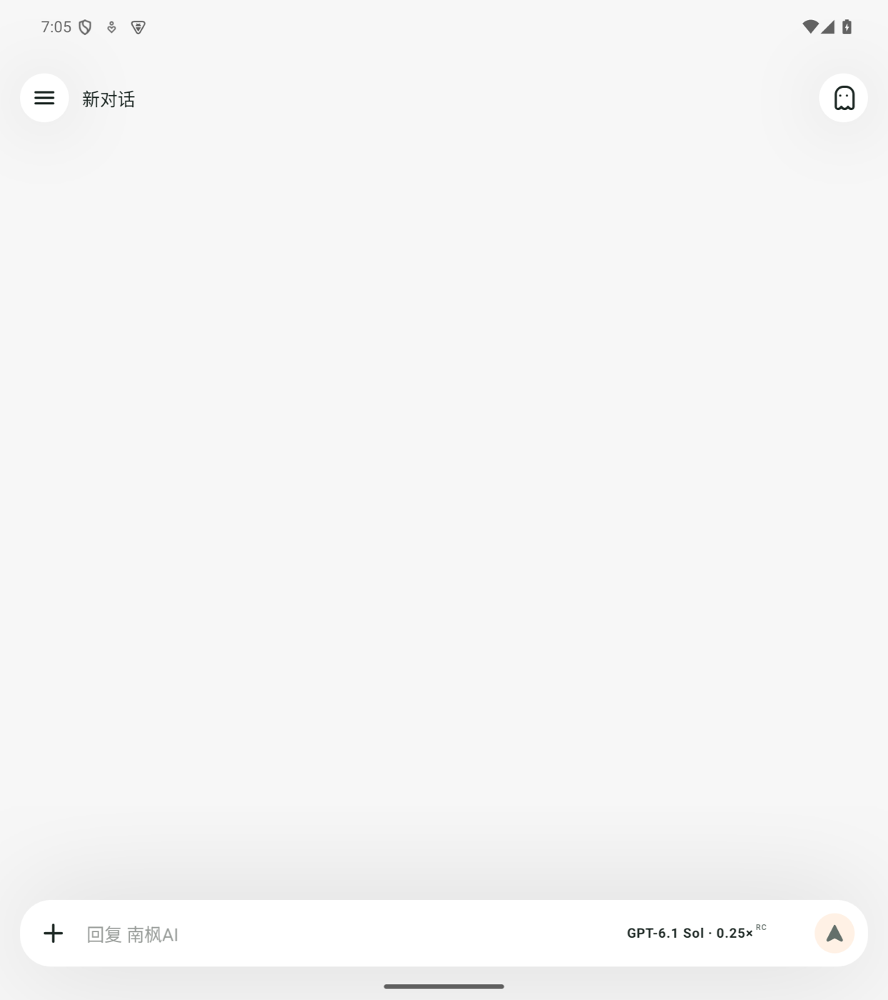
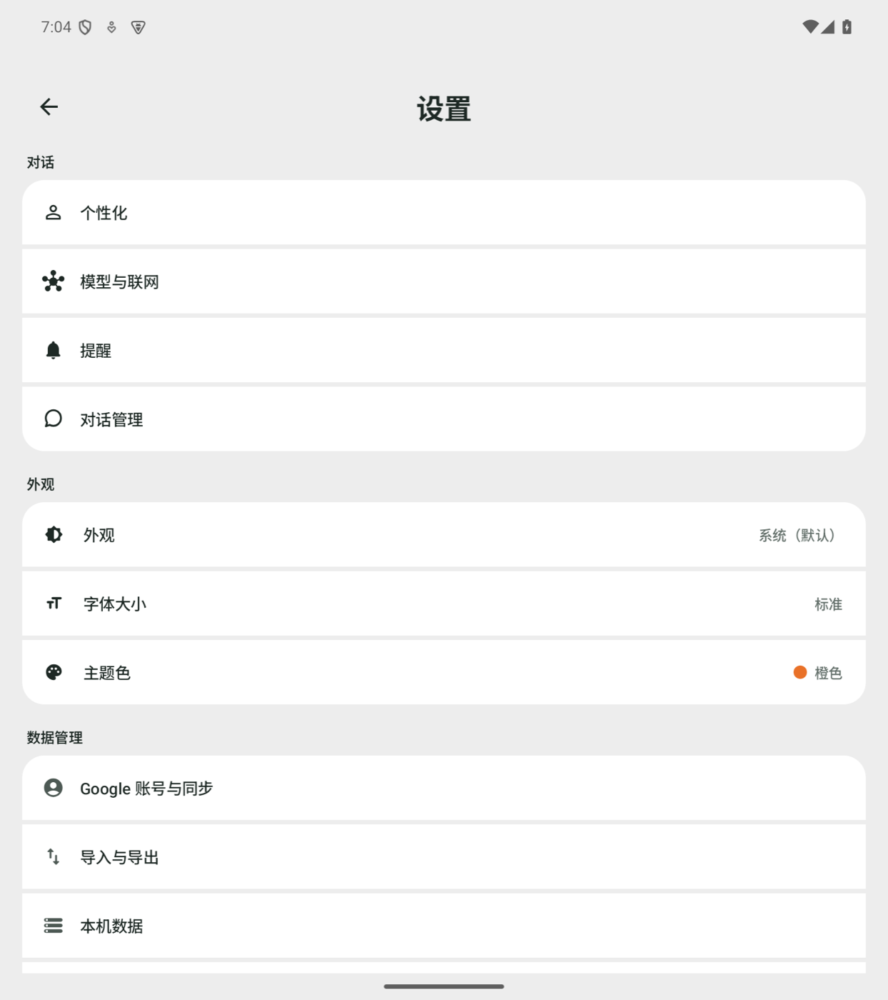
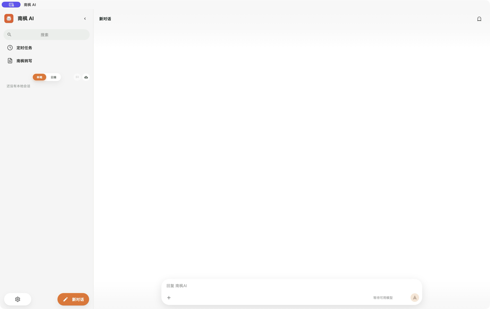

# 南枫 AI

本地优先的个人 AI 工作台，支持 Android 与 macOS。

## 下载

当前发布：[v1.0.31](https://github.com/nanzhufeng/Nanfeng-AI/releases/tag/v1.0.31)

- Android：[APK](https://github.com/nanzhufeng/Nanfeng-AI/releases/download/v1.0.31/Nanfeng-AI-Android-1.0.31.apk)
- macOS：[DMG](https://github.com/nanzhufeng/Nanfeng-AI/releases/download/v1.0.31/Nanfeng-AI-macOS-1.0.31.dmg)（开发签名，未公证）

## 预览

### Android

| 对话 | 设置 |
| --- | --- |
|  |  |

### macOS

| 对话 | 模型与联网 |
| --- | --- |
|  |  |

以上为 v1.0.31 正式候选包正常运行界面：Android 在隔离模拟器采集，macOS 在原生应用独立数据根采集。图片来自已验签、冻结且与上传包一致的版本，仅证明所示界面。Release 提供安装包和校验文件。

## 源码

| 目录 | 内容 |
| --- | --- |
| `app/` | Android |
| `desktop/` | macOS 与未来 Windows 共用的桌面端 |
| `protocol/` | 跨端协议 |
| `supabase/`、`upload-gateway/` | 可选云端组件 |

Windows 必须在 Windows 原生环境单独构建、签名和验收；macOS 包不能替代 Windows 包。

开发规则与当前状态见 [AGENTS.md](AGENTS.md) 和 [当前交接](docs/CURRENT_HANDOFF.md)。
