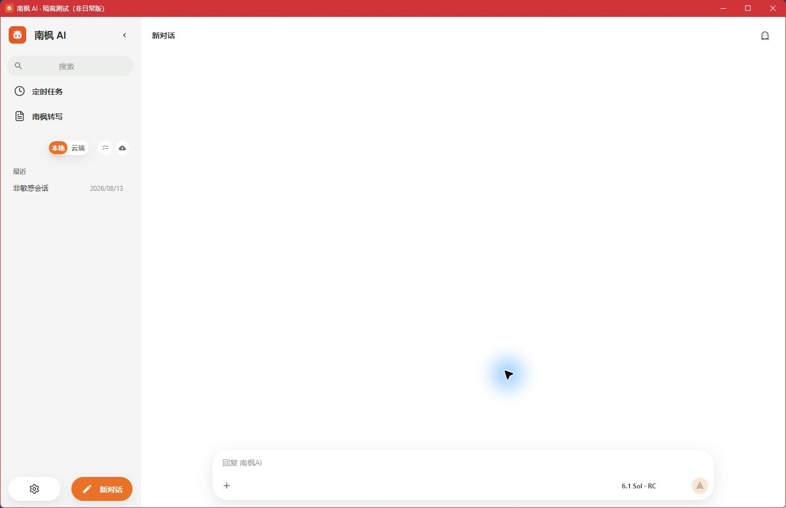
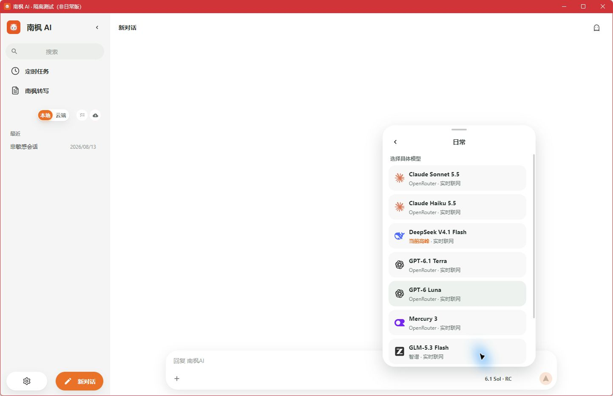
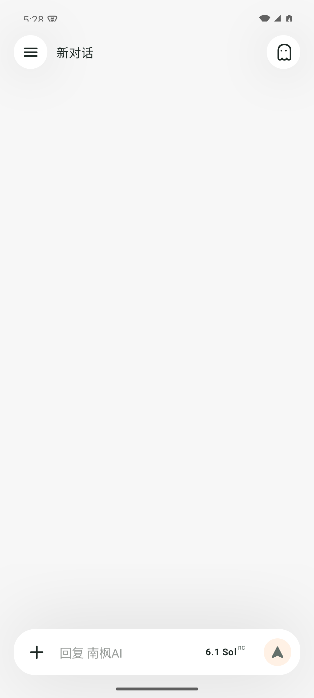
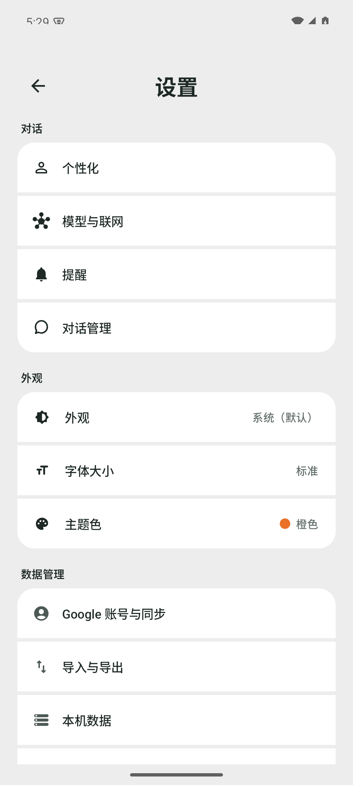
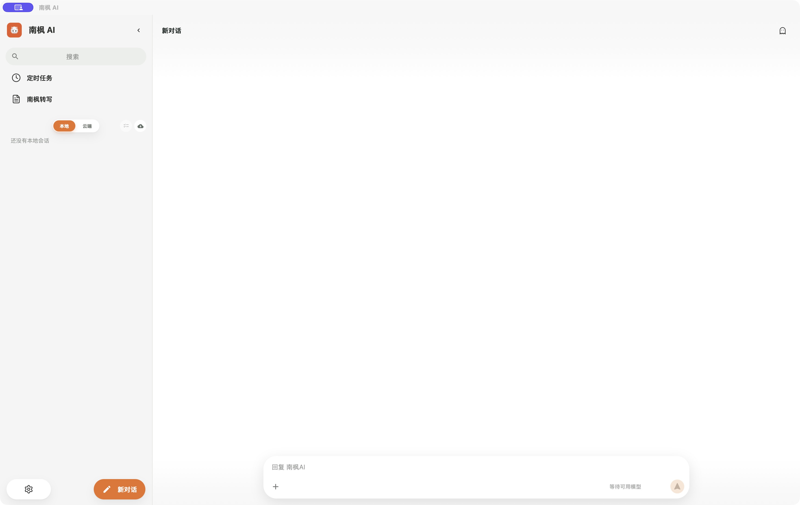
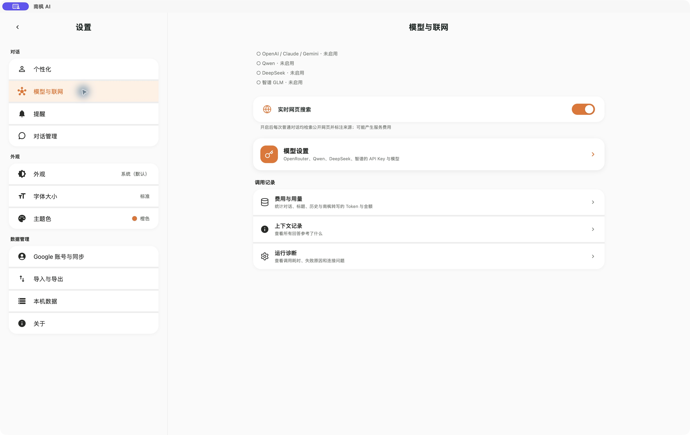

# 南枫 AI

本地优先的个人 AI 工作台，支持 Android、macOS 与 Windows。

## Windows

[下载 Windows 1.0.32 安装包](https://github.com/nanzhufeng/Nanfeng-AI/releases/tag/v1.0.32-windows.1)（x64，未签名 NotSigned）。本次未执行实际覆盖安装，真实模型服务需在软件内配置。

[对应 Windows 源码](https://github.com/nanzhufeng/Nanfeng-AI/tree/codex/windows-release-1.0.32)保存在同仓库发布分支；Mac/Android 主线保持现有实现。

以下为 Windows 1.0.32 当前构建在隔离合成数据中的真实运行截图（1440 × 932）。截图使用独立验收身份，与发布程序共享 409 项构建输入；红色标题栏为隔离标识，未配置真实 API Key。

| 聊天主页 | 模型选择 |
| --- | --- |
|  |  |

## 下载

当前发布：[v1.0.32](https://github.com/nanzhufeng/Nanfeng-AI/releases/tag/v1.0.32)

- Android：[APK](https://github.com/nanzhufeng/Nanfeng-AI/releases/download/v1.0.32/Nanfeng-AI-Android-1.0.32.apk)
- macOS：[DMG](https://github.com/nanzhufeng/Nanfeng-AI/releases/download/v1.0.32/Nanfeng-AI-macOS-1.0.32.dmg)（开发签名，未公证）

## 预览

### Android

| 对话 | 设置 |
| --- | --- |
|  |  |

### macOS

| 对话 | 模型与联网 |
| --- | --- |
|  |  |

以上为 v1.0.32 正式包在隔离空数据环境中的实际界面：Android 使用独立模拟器，macOS 使用原生应用独立数据目录，均未配置 API Key。图片对应已验签、冻结的上传包，仅证明所示界面；Release 提供 APK 和 DMG。

## 源码

| 目录 | 内容 |
| --- | --- |
| `app/` | Android |
| `desktop/` | macOS 与 Windows 共用的桌面端 |
| `protocol/` | 跨端协议 |
| `supabase/`、`upload-gateway/` | 可选云端组件 |

Windows 必须在 Windows 原生环境单独构建、签名和验收；macOS 包不能替代 Windows 包。

开发规则与当前状态见 [AGENTS.md](AGENTS.md) 和 [当前交接](docs/CURRENT_HANDOFF.md)。
