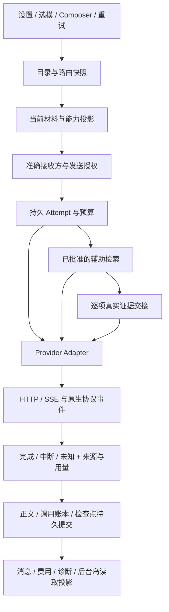

# 模型服务统一架构与设计标准

本页是南枫 AI 模型服务的总入口，适用于 Android 与 Mac。当前模型、分组、API ID及差异见[生成矩阵](MODEL_SERVICE_MATRIX.md)，变更按[维护流程](MODEL_SERVICE_MAINTENANCE.md)。这是仓库实现标准，不是当前官方目录、价格或任意上游服务可用性的声明。

## 1. 范围与事实来源

本次归纳覆盖普通聊天、工作区及标题整理、历史整理、定时监控、文档OCR等模型相关入口。临时会话的模型标识仅用于本地恢复，不调用Provider。不同场景有各自用例与授权，不因为共享模型就共享全部材料、数据库或接收方。

维护目录是 `protocol/model-service/model-service-v1.json`，自动检查入口是 `protocol/scripts/verify-model-service-contract.py`。它约束当前配置、双端一致性、规则归属和文档矩阵；不在运行时另造ModelRegistry、读取Key、决定真实能力或发请求。生产解析能力与执行仍由现有owner持有。新增模型不能只改本页或一份清单。

当前源码和适用的真实证据优先；本页组织规则归属，生成矩阵描述配置，领域合同定义具体行为，CURRENT_HANDOFF记录动态结果。旧阶段报告不能重新激活已退役的模型或协议。

## 2. 结构层级

| 层 | 管理内容 | 唯一维护位置 | 不能混入 |
|---|---|---|---|
| 共用标准 | 精确身份、授权、材料、真实完成、历史保真、失败与计量 | 本页路由到各领域合同 | 某个模型名或促销价决定的规则 |
| 平台与配置身份 | 平台入口、独立Provider ID、固定端点、凭据分组 | 维护目录providers＋各平台配置owner | 把RelayCore三组Key合成一份 |
| 模型部署 | 稳定preset/logical ID、Provider、API ID、选择位置 | 维护目录models＋生产目录／registry／profile | 用展示名当接口ID，修改历史归因 |
| 接口与能力 | 请求封装、原生工具、SSE、effort、预算、媒体投影 | Provider Adapter；逐模型例外明确登记 | 因同品牌就复制其他渠道能力 |
| 场景用例 | 普通发送、重试、搜索协作、附件、后台、OCR | 对应Application UseCase与持久owner | 页面、弹层、岛直接调用Provider |
| 验证与版本 | fixture、迁移、构建、原生与真实服务证据 | 测试／版本化协议／PROJECT_STATUS／交接 | 把静态检查或构建当真实生成成功 |

Android链为Compose/ViewModel → domain/ai/data/background；Mac为ESM → Tauri IPC → Rust/SQLite。相同语义通过共享fixture和门禁保持一致，两端不共享数据库、可恢复句柄或同一份原生验收结论。场景的完整先后次序以执行owner为准，上图是职责依赖，不是新增状态机。

### 项目与通用默认的边界

通用模型服务Skill用于路由方法，本项目已实现的普通聊天行为由项目合同裁决，不直接套用其他南枫产品的AI点评流程。

| 通用／历史默认 | 本项目当前边界 |
|---|---|
| 默认Chat Completions、stream=false、temperature=0.2 | 接口按Provider与模型选择；普通聊天保留原生流；不支持temperature的模型不发送 |
| 生成Dialog→编辑预览→手动保存 | 普通聊天由持久Attempt与执行器提交消息，后台可继续；不因此新增AI点评Dialog |
| 每次新建确认框／生成中禁止关闭 | 已披露正常发送授权不增加重复确认；界面可返回，取消由执行owner负责 |
| 未知旧预设回退默认项 | 当前精确手选／冻结重试不可静默替换；服务配置迁移和历史读取另有有界规则 |
| 模型家族一般支持搜索或视觉 | 只有当前部署／接口／材料投影及验证成立的能力可以使用 |

## 3. 模型身份与配置

区分四个身份：用户选中的logical/preset；可调用部署的Provider＋API ID；本次Attempt冻结身份；服务实际返回身份。展示名、RC角标、分组倍率、能力层级、Key名称和平台返回声明，都不能独立证明真实上游身份。

平台入口与凭据身份分开：RelayCore在设置中是一个平台，Claude/GPT/Gemini是三个独立配置owner。精确接收方、当前目录、默认项与Auto顺序由[选模合同](../P6G_MODEL_SELECTION_AUTO_ROUTER_CONTRACT.md)管理；渠道、角标、倍率和当前已验别名由[RelayCore合同](../RELAYCORE_MODEL_CURRENT_CONTRACT.md)管理。

能力事实分开记录“目录声明”“本接口已实现”“已测试场景”。最终可发送能力是模型声明、Adapter实际请求能力、材料投影、上下文预算、授权和服务状态共同满足的结果。API返回的model缺失就是未验证，不用请求ID补造；历史快照不从当前选择倒推。

## 4. 请求协议与参数差异

统一的是领域语义，不强求所有接口使用相同JSON。Chat Completions、Messages、Responses和辅助检索协作各自有明确序列化与解码owner，协议／端点映射见生成矩阵。

参数必须按模型与接口一起裁决：reasoning.effort与output_config.effort不互换；temperature并非每个模型都接受；最大上下文、输出、推理、搜索次数、响应字节、单次／首字／闲置超时是不同预算，不从“深度／日常”或倍率推测。普通生成、连接测试、标题任务和监控不得默认共用相同输出上限。

共用生成与错误语义由[联网合同](../C12_MODEL_NETWORK_PARITY_CONTRACT.md)及[运行时上下文合同](../ANDROID_RUNTIME_CONTEXT_CURRENT_CONTRACT.md)管理。统一附件准备属于场景执行策略（`CHAT_ATTACHMENT_READING`），不把辅助模型能力写入原选模型原生能力；P6D2持有准备／读取，P3J持有材料和接收方授权，C12持有检索及终态。现用例外在目录exceptions中登记，并指向领域合同；新增参数先补适配器与红绿测试，再登记例外，不在各页面散落模型字符串判断。

## 5. 选择、发送、重试与历史

手动选择、Auto发送前选择和失败后恢复是三种不同动作。Auto只能在发送前从本地可用候选选择；手选模型不可用仍保留选择；失败后不静默换模型、Provider、协议或Key分组。详细顺序见选模合同。

[发送授权合同](../P3J_NORMAL_CHAT_EXPLICIT_EGRESS_CONFIRMATION_CONTRACT.md)唯一拥有材料与接收方披露；当前正常发送和显式重试共用规则。新增检索接收方／材料范围属于授权语义变化，不能靠旧receipt放行。历史版本读取兼容、当前授权有效性、默认预设升级映射、同组API别名、冻结Attempt重试分别验证，不写成一个通用“fallback”。

保存当前模型与重开、旧会话、分支、云端恢复、失败正文和用量的历史保真分别由现有owner负责。主回答／检索的UNKNOWN仅保留状态与断点，不自动重新付费发送。自动标题按用户明确授权的[短任务有界兜底](../ANDROID_CONVERSATION_UI_CURRENT_CONTRACT.md)执行，不能扩展为普通聊天换模型。取消／本地写入失败后不得继续下一段网络调用。

## 6. 附件与联网

[附件合同](../P6D2_CROSS_PLATFORM_COMPOSER_ATTACHMENT_ADAPTER_CONTRACT.md)拥有私有副本、类型与容量、完整正文、Office/PDF/ZIP、单／多／混合附件和媒体边界；[联网合同](../C12_MODEL_NETWORK_PARITY_CONTRACT.md)拥有实际搜索与终态，RelayCore合同拥有辅助检索的有界材料披露与逐项证据。

不能只检索用户短句“分析报告”。当前附件的具体实体、日期、数字和公开网址须进入相应请求；完整遍历所有附件的公共候选事项，再按文件与事项分批；长段拆分保留尾部。缺证有界补查，超出处理／调度预算准确记录未完成范围，不以取样范围替代整项任务。来源必须来自服务结构化结果，正文自行写URL不算证据；源标题、Markdown包装、query定位和原生引用按对应owner解析。

文本接口先本机提取完整正文；原生多模态接口保留它实际支持的原件。图片、扫描PDF、音视频、Office嵌入媒体不是“文本文件支持”的同义词，使用附件合同的原生、本机或已披露辅助路径。Android profile种子与Mac原生输入投影共用`model_profiles.json`；Android已验证动态目录仍优先。Auto优先当前接口可原生接收的候选；需要辅助时同时检查读取方配置，不能从Provider品牌整体推断能力。

附件主题／事项规划、按批检索及原模型回答是不同阶段，每个阶段实际发出的物理调用独立计量；媒体先由原生或准确披露的读取方读出实质内容再搜索，所有主题均可检索，不能用日期／数字／新闻词筛选主题，准确边界由联网合同持有。检索失败后的材料分析仍要保留失败语义、正文和真实用量，不能改成联网成功；取消阻止后续调用。语言由[回答语言合同](../ANSWER_LANGUAGE_CURRENT_CONTRACT.md)统一控制，不在UI事后删英文或重新付费翻译。

## 7. 终态、后台与反馈

“收到HTTP200”“请求开了搜索”“出现工具事件”“已经显示一段文字”“SSE结束”“正文提交完成”是不同事实。Messages/Responses/Chat各自满足适用终态及尾部用量规则，截断、失败、EOF或未知不能冒充完成。

生成owner先提交正文／状态／检查点，UI和[后台岛](../NANFENG_ISLAND_CURRENT_CONTRACT.md)只读准确元数据。岛默认简洁、应用前台隐藏、空白点按收回、无收起按钮、终态有限展示；不猜搜索进度百分比。切页面／退后台不新增网络调用；系统强杀／断网／休眠不能被包装成持久服务端任务。

配置、连接测试、生成错误和诊断有各自对象内反馈，详细规则归[设置合同](../ANDROID_SETTINGS_UI_CURRENT_CONTRACT.md)。所有选模入口共用平台品牌图标与克制字体缩放，窄屏与大字体不能丢失名称／关键归因；界面密度不改变API ID、金额精度或真实状态。

## 8. 费用、用量与来源

[费用合同](../AI_USAGE_COST_AND_BALANCE_LEDGER_CONTRACT.md)拥有每个物理Call的独立usage与价格快照、失败／取消计量、本地恢复和汇总。unknown不是零；输出上限不是实测Token；推理与缓存是协议报告字段，不逐帧累加；记账失败不能重新发送已完成生成。

平台样式、实际币种、是否结算、估算价、汇率和倍率分别保存。RelayCore当前CNY例外不适用于其他Provider；不同币种和未知调用不能直接合计。价格、上下文和能力的外部变化需要独立核验，不靠模型名推断。

## 9. 独立任务与实验模块

GLM-OCR按[OCR合同](../GLM_OCR_DOCUMENT_MARKDOWN_CONTRACT.md)走独立解析接口，不进入普通聊天或Auto。自动标题由ConversationTitleRouting／desktop_conversation_title_v1独立选择；历史整理由TitleAndHistoryRefinementRouting／BACKGROUND_TEXT_REFINEMENT_PRESET_IDS保留原顺序，不因为普通聊天新增模型而自动迁移。

定时监控、转写、P6G实验规划器、Android Compare实验端口、Desktop历史Compare分支兼容与未来Agent能力分别遵守自身合同及授权。实验类源码存在不等于已经接入生产；普通聊天目录不能自动启用Compare、工具执行、多步Agent或扩大自动任务付费范围。

## 10. 权威入口与所有权

维护目录authorities逐项列出领域合同、Android owner、Mac owner和验证入口；门禁检查每个引用存在。这里不再维护第二套owner表。具体实现路径在[生成矩阵](MODEL_SERVICE_MATRIX.md)的上级维护目录中，代码大文件只按符号读取。

| 变更 | 必须连带核对 |
|---|---|
| 新模型／升级 | 目录、profile/registry、默认／Auto／手选、精确归因、连接测试、参数、价格与回归 |
| 新接口／参数 | 序列化、流式／非流式解码、身份、终态、用量、超时及失败保存 |
| 新附件能力 | 选取／私有副本／预览／实际发送／检索要点／拒绝边界与预算 |
| 新联网路径 | 接收方授权、真实工具证明、逐项相关性、来源身份、费用与收尾 |
| 规则或授权升级 | 新发送门禁＋历史读取／恢复＋无UNKNOWN重发 |
| UI或后台反馈 | 共用组件、真实持久状态、前后台、取消／中断和设备形态 |

## 11. 验证标准与维护门

检查顺序：维护目录／源码静态一致 → Provider与领域行为回归 → 受影响入口与历史重开 → 构建 → 隔离原生 → 用户授权范围内的真实服务／真实设备。每层独立报告，skip不省略。永久不运行connected类Android测试，不为维护任务安装、清库或调用私人原件。

静态门禁覆盖配置身份／API ID／默认项、聊天与OCR分离、Relay显示与分组、Auto顺序、关键工具请求、owner文件与生成矩阵。它不能证明所有模型在上游当前可用。未来改变受检查源码的声明结构时，更新静态读取器及反例测试，不能删检查或给所有模型开放默认通过。

范围到此为规则归纳、合同冲突修正与维护门禁；没有全面改写网络／存储owner或引入第二个运行时注册表。后续逐步消除硬编码时仍以一条可验证调用链为增量，不以“大重构完成”代替行为证据。
