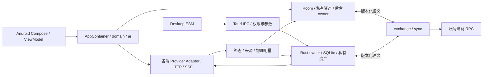

# 南枫 AI 完整开发档案

> 复盘日期：2026-10-30。当前本地 HEAD 为 `0c5afbdbf61c7d50fd8f257720f3b92763901083`，业务代码 checkpoint 为 `2c22021c861ce2e74022e94cf116dfa47ada1201`，本地标签 `checkpoint-model-service-20261030`。本次只修改文档与项目 Skill，不修改业务源码、配置、schema或应用测试，不安装、收费调用、提交或发布。旧版本正文可从上述 Git 基线恢复。

当前行为以[合同索引](contracts/CONTRACT_INDEX.md)和适用领域合同为准；模型维护从[统一架构](model-service/MODEL_SERVICE_ARCHITECTURE.md)进入。本档案解释目标、实现和演进，不建立第二套行为规则。动态交接见[项目状态](PROJECT_STATUS.md)、[当前交接](CURRENT_HANDOFF.md)。

## 1. 复盘方法、范围与证据等级

| 检查层 | 本轮实际范围 | 能证明什么／限制 |
|---|---|---|
| 文件清单 | 1,954个已跟踪＋323个非ignored未跟踪，共2,277个文件；2,158个文本、119个二进制 | 每文件路径、大小、类型、行数、SHA-256和tracked身份；未读取ignored私有配置、凭据、应用数据库或构建缓存。二进制仅核身份，未逐图视觉验收 |
| 结构与适用语法 | 所有清单项均有结构路由；Python15、JSON438、XML87、Node216、Bash5、Zsh1项语法通过 | 762项适用语法通过，7项历史取证XML失败；1,389项不在此语法检查器支持范围，另119个非文本。Kotlin／Rust／SQL并未由此脚本编译或执行 |
| 本地Git历史 | 所有本地ref可达202提交，当前HEAD祖先200；日期2026-08-20至2026-10-30 | 每条提交的主题、日期、路径和增删统计；按关键owner抽查演进。未fetch，不能宣称覆盖远端不可达历史或仓库建立前过程 |
| 文档导航 | 扫描319份Markdown的常见本地内联链接 | 37个缺失引用全部属于迁移位置的before-docs历史快照；活跃文档未见此类缺链。外链、片段锚点、绝对本机路径不作为便携链接已验证的证明 |
| 定向语义核对 | 组合根、普通发送／附件／检索／计量、Room／SQLite迁移、分区、导入备份、账号同步、后台、云服务／网关、CI与交付 | 结合源码、当前合同及已有回执检查；全量结构扫描不等于全仓逐行语义证明，也不证明每个原生／真实服务组合 |

[本轮报告](verification/2026-10-30-project-retrospective/REPORT.md)、[文件清单](verification/2026-10-30-project-retrospective/files.json)、[结构结果](verification/2026-10-30-project-retrospective/structure.json)、[完整本地历史](verification/2026-10-30-project-retrospective/history.json)和[历史范围](verification/2026-10-30-project-retrospective/history-scope.json)保存可复核依据。清单是修改前快照，不要求包含其自身或随后生成的复盘文件。

两个不在当前主线上的本地提交为 `d519e83ccb`、`8d434cbdaa`；与主线checkpoint主题接近，不能据此计算成两轮产品开发。Git日期与主题不证明实际工时、作者动机、首次开发日期或部署完成。

## 2. 项目目标与产品边界

南枫 AI 是本地优先的个人 AI 工作台，产品目标平台为 Android 与 macOS，包含普通聊天、模型服务、附件读取与检索、知识／工作区相关存储、费用记录、导入备份、账号同步及后台任务。目标依据[README](../README.md)、[产品及领域owner索引](contracts/DOMAIN_OWNER_MAP.md)，不是“全功能离线”或“全部服务均已上线”的承诺。

- 当前可见产品以聊天为主；WORK已有独立数据和恢复owner，但入口隐藏。隐藏不等于删除、并库或授权自动引用另一数据区。[C15](C15_WORKSPACE_KNOWLEDGE_PARITY_CONTRACT.md)、[数据区命名](../app/src/main/java/com/nanzhufeng/ai/domain/ConversationDataArea.kt)。
- Android与Desktop不交换各自数据库文件；交换和同步通过版本化语义、校验、暂存、持久化及回读衔接。[exchange v1](NFAI_EXCHANGE_V1_CONTRACT.md)、[ADR-002](ADR-002-P6A_DESKTOP_AND_EXCHANGE.md)。
- 选择、草稿和预览优先本地；发送按准确材料、Provider、模型、Key分组及已授权接收方执行。上游服务、网关和云同步属于明确外部边界。[运行上下文](ANDROID_RUNTIME_CONTEXT_CURRENT_CONTRACT.md)、[C12](C12_MODEL_NETWORK_PARITY_CONTRACT.md)。
- Windows、线上云服务部署、公证和所有模型媒体组合不能由目录、编译或历史截图推断完成；见第10节。

## 3. 技术栈、配置与目录

下表是本仓库当前声明和代码事实，不代表本轮联网核验了第三方最新版本。

| 层 | 当前配置／实现 | 依据 |
|---|---|---|
| Android构建 | 单`:app`；AGP9.3.1、Gradle9.5.0、Compose plugin2.2.10、KSP2.2.10-2.0.2；minSdk26、compile／targetSdk36；产品1.0.32/code96 | [根Gradle](../build.gradle.kts)、[wrapper](../gradle/wrapper/gradle-wrapper.properties)、[app Gradle](../app/build.gradle.kts) |
| Android业务 | Kotlin、Compose／Material3、Room2.8.4、WorkManager、Credentials／Google ID、PDFBox Android；Keystore与私有文件 | [依赖／签名／验收sourceSet](../app/build.gradle.kts)、[Manifest](../app/src/main/AndroidManifest.xml) |
| Android持久化 | `NanfengAiDatabase` version72；连续迁移与Room schemas；CHAT／WORK独立文件和区域身份 | [数据库](../app/src/main/java/com/nanzhufeng/ai/data/local/NanfengAiDatabase.kt)、[分区owner](../app/src/main/java/com/nanzhufeng/ai/data/local/ConversationAreaDatabaseOwner.kt)、[schemas](../app/schemas) |
| Desktop | HTML／CSS／ESM；Tauri2、Rust2021、rusqlite0.37、reqwest0.12、serde及PDF／ZIP／XML adapter；没有React／Vite构建层 | [package](../desktop/package.json)、[Cargo](../desktop/src-tauri/Cargo.toml) |
| Desktop身份／数据 | 产品1.0.32、`com.nanzhufeng.ai.desktop`；主store迁移至user_version45；TEMP、模型等其他store分别有owner | [Tauri配置](../desktop/src-tauri/tauri.conf.json)、[主库迁移](../desktop/src-tauri/src/lib.rs)、[数据区](../desktop/src-tauri/src/desktop_data_area.rs) |
| 协议／治理 | exchange v1/v2、sync golden；模型维护manifest、合同registry／owner map | [protocol](../protocol)、[模型架构](model-service/MODEL_SERVICE_ARCHITECTURE.md)；不是共享运行时数据库或第二套动态ModelRegistry |
| 云服务 | Supabase SQL／账号RPC／RLS；Google头像Edge Function与来源策略 | [migrations](../supabase/migrations)、[头像函数](../supabase/functions/google-avatar/index.ts) |
| 附件网关 | Go1.24声明、Docker、offset续传、SHA-256完整性与短时签名URL | [go.mod](../upload-gateway/go.mod)、[服务](../upload-gateway/main.go)、[部署说明](../upload-gateway/README.md) |

Desktop npm／Cargo包名仍含spike、内部版本为0.0.1，安装产品版本由Tauri配置决定；两者不是同一字段。Room最新schema、Desktop主store user_version、独立store版本和应用版本也不能互换。

| 目录 | 修改前清单／职责 |
|---|---|
| `app/` | 839项；main Java目录363份Kotlin，test目录336项其中333份Kotlin；正式资源、72代schema文件、隔离验收代码；acceptanceSupport不进入正式main |
| `desktop/` | 293项；前端src79项、Rust src52项、Node tests120项；脚本、IPC、权限及原生封装 |
| `protocol/` | 44项；格式、合成fixture、模型与合同维护门 |
| `supabase/`／`upload-gateway/` | 17／5项；SQL、头像策略、服务源码和测试，不等于线上环境清单 |
| `docs/` | 1,021项；现行／限定／历史合同、ADR、决策、回执与快照，文件数不等于现行合同数 |
| `.agents/skills/`／`scripts/` | 13／14项；五类项目Skill、清单工具及专项验证脚本 |
| `.github/`／`delivery/`／`artwork/` | CI定义、历史交付清单、图标／预览；不凭文件存在判当前安装或发布状态 |

目录数来自[文件清单](verification/2026-10-30-project-retrospective/files.json)。`lib.rs`30,410行、`ConversationWorkspace.kt`11,935行、`app.mjs`6,992行是维护集中度信号；本次未据行数判定功能错误，也未进行业务拆分。

## 4. 架构与数据流

这是职责图，不是两端共用同一Transport或状态机代码。Android由[Activity](../app/src/main/java/com/nanzhufeng/ai/NanfengAiActivity.kt)、[ViewModel](../app/src/main/java/com/nanzhufeng/ai/ui/ConversationFoundationViewModel.kt)、[AppContainer](../app/src/main/java/com/nanzhufeng/ai/app/AppContainer.kt)装配；Desktop由[app.mjs](../desktop/src/app.mjs)、[chat-shell](../desktop/src/chat-shell.mjs)、[runtime-chat-commit](../desktop/src/runtime-chat-commit.mjs)及[Rust注册／存储](../desktop/src-tauri/src/lib.rs)衔接。界面是状态投影，浏览器fixture不是正式SQLite验收。

### 普通发送与附件联网

1. 草稿和材料本地准备 → 路由／精确身份冻结 → 材料及接收方校验 → 持久Attempt → 实际Adapter／Transport → 完成、已知失败、取消或UNKNOWN → 正文／来源与独立计量事实持久化 → UI回读。[Android执行器](../app/src/main/java/com/nanzhufeng/ai/ai/NormalChatOpenRouterExecutor.kt)、[Desktop执行器](../desktop/src-tauri/src/desktop_ordinary_chat_v1.rs)、[P3B](P3B_RUNTIME_EVENT_STATE_MACHINE_CONTRACT.md)。
2. 材料需要清点／识读时，先由适用原生或已披露辅助接收方取得可用材料；事项计划分批检索、绑定来源与检查点，再交回原选模型回答。不限主题不等于未经实现的任意格式可读；局部来源也不等于所有事项核实。[清点](../app/src/main/java/com/nanzhufeng/ai/ai/AttachmentSearchInventory.kt)、[Android聚合](../app/src/main/java/com/nanzhufeng/ai/ai/AttachmentWebSearchCoordinator.kt)、[Desktop聚合](../desktop/src-tauri/src/attachment_web_search_execution_v1.rs)。
3. 当前维护manifest有23聊天部署：OpenRouter10、官方7、RC6；另1独立OCR、7凭据组。它描述精确部署与维护约束，不证明上游当前可用。[manifest](../protocol/model-service/model-service-v1.json)、[生成矩阵](model-service/MODEL_SERVICE_MATRIX.md)。Terra、Mercury、Gemini展示名及部署ID不能混为一谈。
4. 正常OpenRouter／官方路线各自保持；RC普通文字Sol／Astra自身Responses，其他四款RC文字及六款RC附件使用登记的Luna检索后交回原模型。Muse、Gemini、Haiku等精确协议例外只沿对应Adapter／C12使用，不推广为品牌级fallback。[RC合同](RELAYCORE_MODEL_CURRENT_CONTRACT.md)、[Adapter](../app/src/main/java/com/nanzhufeng/ai/ai/ChatProviderAdapters.kt)、[统一架构](model-service/MODEL_SERVICE_ARCHITECTURE.md)。
5. 阶段聚合必须保留失败确定性；UNKNOWN、取消、本地持久化或外发授权失败不能因已有部分结果变Ready并继续收费。已知明确检索失败可否分析材料由C12裁决。已完成检查点和已知计量不因此抹去。[当前修复](verification/2026-10-30-risk-boundary-audit/REPORT.md)。

### 费用、导入、同步与后台

- 费用从物理Call的实际模型、输入／缓存／推理Token、Provider金额与币种冻结。原始账本和展示聚合分开；检索可按任务合并展示，原回答独立，未知不伪造零。中断事实保留以实际支持的失败类型为准，不宣称所有取消／超限已具备partial计量。[费用合同](AI_USAGE_COST_AND_BALANCE_LEDGER_CONTRACT.md)、[Android估价](../app/src/main/java/com/nanzhufeng/ai/domain/ConversationCostEstimator.kt)、[Desktop账本](../desktop/src-tauri/src/chat_call_accounting_v1.rs)。
- 导入／备份：显式选择 → 格式／大小／路径校验 → 私有暂存 → hash／source identity／引用与occurrence → 事务或journal提交 → receipt与重开。两端独立资产生命周期不靠复制数据库兼容。[P2A](P2A_LOCAL_DATA_AND_ATTACHMENT_CONTRACT.md)、[P5D](P5D_LOCAL_BACKUP_RESTORE_DELIVERY_CONTRACT.md)、[P6K](P6K_CHATGPT_CLAUDE_ZIP_IMPORT_ADOPTION_CONTRACT.md)、[Android备份owner](../app/src/main/java/com/nanzhufeng/ai/data/AndroidLocalBackupRestoreManager.kt)。
- 同步：选定会话和区域身份 → 账号范围RPC与revision → 结构化载荷／字段版本合并 → 本地receipt和UI刷新。现行`nfai.sync.direct`携带payload对象，服务端可读取；HTTPS、账号隔离与hash不是E2EE。旧密文保留用于源端迁移，不能因残留cipher代码误称当前全部加密。[SQL](../supabase/migrations/202609180007_p8_account_isolated_sync.sql)、[Android同步](../app/src/main/java/com/nanzhufeng/ai/data/P7FManualConversationSync.kt)、[Desktop同步](../desktop/src-tauri/src/desktop_account_sync_v1.rs)、[P7F](P7F_SELECTED_CONVERSATION_SYNC_CONTRACT.md)。
- 长任务状态由持久执行／后台owner管理，返回页面不应创建第二次Provider请求。通知、转写、提醒、监控与取消涉及各端OS边界；Manifest或代码存在不证明主设备后台行为通过。[P5B](P5B_BACKGROUND_CANCELLATION_BATTERY_CONTRACT.md)、[南枫岛](NANFENG_ISLAND_CURRENT_CONTRACT.md)、[Desktop后台](../desktop/src-tauri/src/desktop_background_runtime_v1.rs)。

## 5. 核心模块

| 模块 | 当前owner／合同导航 | 后续维护重点 |
|---|---|---|
| 会话、分支、草稿、生命周期 | [Room仓库](../app/src/main/java/com/nanzhufeng/ai/data/local/RoomConversationRepository.kt)、[C13](C13_CONVERSATION_LIFECYCLE_PARITY_CONTRACT.md)、[Desktop普通聊天](../desktop/src-tauri/src/desktop_ordinary_chat_v1.rs) | 身份、revision、事务、迟到回读、失败保稿、取消和重开 |
| 模型选择、请求、附件、联网 | [Android执行器](../app/src/main/java/com/nanzhufeng/ai/ai/NormalChatOpenRouterExecutor.kt)、[Desktop模型服务](../desktop/src-tauri/src/desktop_model_service_v1.rs)、[C12](C12_MODEL_NETWORK_PARITY_CONTRACT.md) | 目录、能力、实际序列化、授权、来源、终态、费用和停止边界一起核对 |
| 工作区、项目、知识、上下文 | [domain](../app/src/main/java/com/nanzhufeng/ai/domain)、[Desktop知识](../desktop/src-tauri/src/desktop_history_knowledge_v1.rs)、[C15](C15_WORKSPACE_KNOWLEDGE_PARITY_CONTRACT.md) | 区域隔离、人工引用、资料revision及派生索引；隐藏入口不删owner |
| 资产、搜索、解析、导入备份 | [Android备份](../app/src/main/java/com/nanzhufeng/ai/data/AndroidLocalBackupRestoreManager.kt)、[Desktop备份](../desktop/src-tauri/src/desktop_local_backup_v1.rs)、[C14](C14_LOCAL_DATA_PARITY_CONTRACT.md) | 字节与引用一致、路径／hash、原子提交、journal、失败与恢复 |
| 账号、同步、凭据 | [Android账号](../app/src/main/java/com/nanzhufeng/ai/data/P7FGoogleAccountSession.kt)、[Desktop同步](../desktop/src-tauri/src/desktop_account_sync_v1.rs)、[P7F](P7F_SELECTED_CONVERSATION_SYNC_CONTRACT.md) | 账号切换、presence／read分离、payload真实信任边界、并发revision与删除意图 |
| 提醒、监控、转写 | [Desktop提醒](../desktop/src-tauri/src/desktop_reminders_v1.rs)、[转写](../desktop/src-tauri/src/desktop_transcription_v1.rs)、[Android监控](../app/src/main/java/com/nanzhufeng/ai/ai/ScheduledMonitorExecutor.kt) | 持久任务、计费外部动作、通知权限与系统生命周期分别验收 |
| UI、设置、皮肤、字体、复制 | [ConversationWorkspace](../app/src/main/java/com/nanzhufeng/ai/ui/ConversationWorkspace.kt)、[C16](C16_THEME_FONT_OVERLAY_PARITY_CONTRACT.md)、[Android设置](ANDROID_SETTINGS_UI_CURRENT_CONTRACT.md) | 原生选择、窄屏／外屏、大字体、输入与焦点；不擅加常驻小字或开发入口 |
| 协议、云、网关及治理 | [protocol](../protocol)、[Supabase](../supabase)、[网关](../upload-gateway)、[owner map](contracts/DOMAIN_OWNER_MAP.md) | 公共格式、RPC／RLS、offset／TTL、部署事实、CURRENT／SCOPED边界 |

表格是入口导航。实验Compare、独立OCR、旧格式与普通聊天分别查其合同，不能由存在代码推断当前入口可见或允许外部动作。

## 6. 关键决策与原因

只采用文档明确记录的原因，不从代码形状或提交主题补造动机。

| 决策 | 已记录原因／取舍 | 依据 |
|---|---|---|
| 本地优先、发送绑定材料与接收方 | 选择／预览不外发；实际调用须可归因，不静默扩大范围 | [运行上下文](ANDROID_RUNTIME_CONTEXT_CURRENT_CONTRACT.md)、[决策日志](decision-log.md) |
| 双端独立数据库、共享语义 | Room与Desktop SQLite的表／资产生命周期不同，协议边界处理兼容 | [ADR-002](ADR-002-P6A_DESKTOP_AND_EXCHANGE.md) |
| CHAT／WORK物理分区 | 单个projectId过滤不能隔离消息、搜索、同步和恢复；无项目WORK仍有区域身份 | 提交`1580faf508`、[C15](C15_WORKSPACE_KNOWLEDGE_PARITY_CONTRACT.md) |
| direct同步保留旧envelope | 现行账号隔离方案不以恢复材料阻塞日常同步，同时保留旧源迁移能力 | [P7F](P7F_SELECTED_CONVERSATION_SYNC_CONTRACT.md)、[SQL](../supabase/migrations/202609180007_p8_account_isolated_sync.sql) |
| 精确路由例外而非全局fallback | 保留已有效自身联网，指定RC场景采用Luna→原模型；品牌相同不足以复用协议参数 | [目标方案](model-service/SEARCH_ROUTING_TARGET_PLAN_2026-10-13.md)、[C12](C12_MODEL_NETWORK_PARITY_CONTRACT.md) |
| 原生来源、项覆盖与完整终态分别成立 | HTTP200、模型自述和正文链接不足以证明联网成功；局部状态也不能覆盖实际完整终态 | [决策日志](decision-log.md)、[DeepSeek修复](verification/2026-10-13-deepseek-terminal-fix/REPORT.md) |
| 物理计量与展示投影分开 | 检索统计可合并，历史Call、币种、价格来源与原回答保持独立 | [费用合同](AI_USAGE_COST_AND_BALANCE_LEDGER_CONTRACT.md) |
| 完成后的可选元数据走专用事务 | 普通save保持历史消息不可变；追加思考须绑定运行、幂等、冲突和重开验证 | [10月15日修复](verification/2026-10-15-other-model-network-review/REPORT.md)、[Room owner](../app/src/main/java/com/nanzhufeng/ai/data/local/RoomConversationRepository.kt) |
| 保留原架构，修复失败确定性 | UNKNOWN在聚合中丢失会产生下一次收费；不能用切模型、重试或新UI掩盖 | [10月30日决策](decision-log.md)、[红绿证据](verification/2026-10-30-risk-boundary-audit/red-check.json) |
| 唯一合同正文＋分层证据 | 历史／实验规则不能倒灌当前实现，代码、原生、主设备、服务和发布各有证据边界 | [合同治理](CONTRACT_GOVERNANCE_CURRENT.md)、[发布策略](GITHUB_REPOSITORY_AND_RELEASE_POLICY.md) |

## 7. 开发过程与代表性修复

### 已提交过程

本地全部ref可达提交按月份为8月142、9月40、10月20；这不是工时统计。最早基线已含大量实现，无法据此复原Git之前的开发起点。以下依据[全历史](verification/2026-10-30-project-retrospective/history.json)、对应代码路径和专项报告，提交主题本身不证明功能完成。

| 阶段／可定位记录 | 仓库记录的变化与依据 |
|---|---|
| 2026-08-20起，`e56d666d89` | 建立已有项目基线；后续P0–P11范围、SAF恢复、exchange／Desktop入口、签名和真实服务门记录。阶段文档须按当时范围阅读 |
| 2026-08末 | 导入资产计数、媒体／搜索、UI与平台交付细节；如`60f4820ea5`的ZIP计数、`2fec04cefb`的Android媒体／搜索路径 |
| 2026-09，`1580faf508` | CHAT／WORK分库与账号同步加强；代码和SQL同时体现区域／revision边界 |
| 2026-10-13至15 | 联网路由、事实粒度、附件全主题、Provider协议与费用归属密集修正；[全主题报告](verification/2026-10-15-attachment-search-all-topics/REPORT.md)、[checkpoint](verification/2026-10-15-code-checkpoint/REPORT.md) |
| 2026-10-15，`9556605a58`／`fe504fec14` | Desktop首次空数据启动与模型元数据入口修复；[v1.0.31回执](verification/2026-10-15-github-v1.0.31/REPORT.md)区分源码与实际交付 |
| 2026-10-20至28；代码归入`7fc4568911` | Mercury／Terra等模型和附件链路演进；[Mercury](verification/2026-10-20-mercury-daily/REPORT.md)、[全模型附件](verification/2026-10-21-all-model-attachments/REPORT.md)、[Terra真实链路](verification/2026-10-28-terra-live-chain/REPORT.md)。过程日期来自报告，不把单个10月28提交当作所有工作的发生日 |
| 2026-10-28，`7fc4568911`／`096341f8d6` | v1.0.32打包、上传及下载回读证据；[发布报告](verification/2026-10-28-github-v1.0.32/REPORT.md)。本轮未重新查询GitHub |
| 2026-10-30，`2c22021c86`／`0c5afbdbf6` | 诊断刷新、Transport／阶段聚合／计量与验收预算修复、合同和文档固化；[最新checkpoint](verification/2026-10-30-code-checkpoint/REPORT.md)。代码本地已提交，未据此宣布新包已安装／发布 |

本轮开始时已跟踪工作树干净；323份未跟踪项均为此前历史取证／before快照和设计图，不是漏纳Git的核心实现。本次新增的是文档／Skill修订与复盘证据；业务源码基线不变。

### 踩坑、修复与证据边界

| 问题 | 已确认分叉／修复 | 证据与不能推断之处 |
|---|---|---|
| 附件受主题／关键词门控制，搜索泛化或无关 | 原选读取→事项计划→相关证据→原选回答；不限主题仍遵守实际材料能力 | [全主题修复](verification/2026-10-15-attachment-search-all-topics/REPORT.md)；不是任意格式已实测 |
| Mercury附件无法直接送达或识读终态被误判 | 显式辅助识读、原模型回答；完成判据沿真实SSE协议保留 | [识读终态修复](verification/2026-10-21-mercury-reading-terminal/REPORT.md)、[混合附件验收](verification/2026-10-21-real-attachment-roundtrip/REPORT.md) |
| 思考已回但保存失败 | 通用不可变save与可选补写职责不同；专用事务绑定运行并幂等追加 | [其他模型修复](verification/2026-10-15-other-model-network-review/REPORT.md)；不放宽所有历史消息可改 |
| 连接关闭异常抹去完整响应、读IO丢已知计量 | Transport独占关闭、协议终态与清理分开；已解码事实进入原计量owner | [Opus阶段报告](verification/2026-10-30-opus-eof/REPORT.md)；不证明原499是谁关闭 |
| UNKNOWN被聚合成普通失败／Ready，继续收费 | 双端清点／分批／补检／最终回答保留停止边界，已完成检查点保留 | [风险报告](verification/2026-10-30-risk-boundary-audit/REPORT.md)；不能用已有部分结果伪造全成功 |
| 流超时计量消失、思考／工具／注释绕过大小门 | Android保留已解码计量；reader前按raw bytes限制 | 同报告中的红绿回归；取消／超限partial计量类型仍有缺口 |
| 验收预算仅返回后写入，后续成功清空早前未知 | 测试Ledger网络前落盘预留，结算仅替换本笔，不清早前未知 | [Ledger](../app/src/acceptanceSupport/java/com/nanzhufeng/ai/acceptance/PublicAcceptanceBudgetLedger.kt)及[测试](../app/src/test/java/com/nanzhufeng/ai/acceptance/PublicAcceptanceBudgetLedgerTest.kt)；不是服务端硬额度 |
| 旧测试把504当明确可继续失败、成功清点省略终态 | 用明确拒绝夹具测可继续分支，未知和缺终态单独拒绝 | [红绿记录](verification/2026-10-30-risk-boundary-audit/red-check.json)；没有放宽生产成功判据求绿 |
| 历史状态与当前源码混用 | 精确commit／输入hash／APK hash／安装回执分别绑定 | [checkpoint](verification/2026-10-30-code-checkpoint/REPORT.md)；产品版本相同不等于同字节或同验收范围 |

## 8. 测试、验证与交付方式

### 当前证据与本轮执行

| 层 | 已有或本轮实际结果 | 适用范围 |
|---|---|---|
| Android全JVM | 2026-10-30最终1578 PASS／10 skip／0失败 | [回归回执](verification/2026-10-30-risk-boundary-audit/android-tests.json)；本轮核对784输入0漂移复用，不重复编译或冒称新执行 |
| Rust全套 | 同日472 PASS／38 ignored／0失败 | [最终回执](verification/2026-10-30-risk-boundary-audit/final-check.json)，同代码；不替代macOS原生全部场景 |
| Desktop Node／静态构建 | 前轮checkpoint新跑563 PASS／12skip，lint／typecheck／inventory／build通过 | [checkpoint回归](verification/2026-10-30-code-checkpoint/regression.json)；静态inventory仍有83个action／41个invoke无测试引用，非全行为覆盖证明 |
| Android正式包 | 同日Release／验收包／Lint／原签名通过 | [产物身份](verification/2026-10-30-risk-boundary-audit/candidate.json)；最新正式候选未覆盖主设备，产物内构建提交不随文档commit改变 |
| 本轮全文件／文档／Skill | 2,277项清单与结构，适用语法、链接、合同门、五Skill结构及收尾保真 | [本轮报告](verification/2026-10-30-project-retrospective/REPORT.md)记录实际运行；不是Kotlin／Rust／SQL运行验证 |
| 本轮云／网关本地检查 | Supabase策略／合同10 PASS，Go网关测试PASS | 合成／本地验证；未调用生产RPC、部署SQL或验证在线网关 |
| 历史真实服务／设备 | Opus用户确认现装可用；其余22模型真实Markdown附件与旧候选重开成功；Terra等另有专项媒体／联网回执 | [22模型矩阵](verification/2026-10-30-other-model-stream-audit/all22-matrix.json)、[Terra](verification/2026-10-28-terra-live-chain/REPORT.md)、[Opus](verification/2026-10-30-opus-eof/REPORT.md)；不证明最新源码全媒体／联网组合已验 |

测试数是执行结果，不是覆盖率。skip／ignored、复用／新跑、单测／合成／原生／主设备／真实服务必须分别报告。定向JVM会覆盖同一XML目录，保留全套摘要后再跑定向；流程见[测试交付Skill](../.agents/skills/nanfeng-ai-testing-delivery/SKILL.md)。

### CI与本地运行

[当前workflow](../.github/workflows/source-verification.yml)声明三job：协议／模型及合同治理／Supabase静态／Go，Desktop lint／typecheck／build／Rust库测试，以及Android `compileDebugKotlin`。它不执行全套Android JVM、Node全套、正式签名包、主设备或真实服务；也尚未接入`audit-contract-consistency.py`及对应一致性测试。配置存在不代表本轮云端运行过；本轮未查远端运行状态。

可复用命令由[测试交付Skill](../.agents/skills/nanfeng-ai-testing-delivery/SKILL.md)、[模型维护流程](model-service/MODEL_SERVICE_MAINTENANCE.md)、各服务README维护，本文不复制第二套命令清单。永久禁止connected Android测试；隔离应用、主设备和外部付费动作各遵守现有授权边界。

### 部署与保数据交付

- Android：正式Gradle构建读取已配置正式凭据；核对applicationId、非Debug、版本、证书与精确APK后，才按用户授权保数据覆盖。不能用卸载／清数据完成升级。实例见[Opus覆盖回执](verification/2026-10-30-opus-eof/phone-cover-check.json)。
- macOS：由Desktop静态产物及Tauri／Rust构建bundle，签名、独立数据根运行、产物身份与DMG回读分别核对；仓库README标注当前发布为开发签名、未公证。本轮未重打macOS包。[发布策略](GITHUB_REPOSITORY_AND_RELEASE_POLICY.md)、[打包脚本](../desktop/scripts/bundle-macos.mjs)。
- GitHub：代码、标签、Release资产和公开下载字节逐层核对，README预览在仓库，Release只放安装包与校验文件。2026-10-28的v1.0.32发布属于历史已验回执；本轮本地checkpoint尚未推送或发布。[发布回执](verification/2026-10-28-github-v1.0.32/REPORT.md)。
- Supabase／头像函数：仓库SQL、Edge Function和策略测试是部署输入，真实账号隔离、RPC／RLS及函数上线需另有环境证据。本轮不执行远端变更。
- 网关：受限持久卷、TLS反向代理、独立访问令牌、公开HTTPS地址、保留时间和短时URL由部署环境提供；源内不存模型Key。默认值、offset冲突、完整性及取消清理以[网关README](../upload-gateway/README.md)和服务代码为准，未确认线上运行。

## 9. 文档冲突与裁决

| 旧来源／断言 | 当前事实 | 本次裁决 |
|---|---|---|
| 原档案技术表1.0.31/code95 | app Gradle为1.0.32/code96，Tauri产品1.0.32 | 更新当前技术表；保留历史发布报告原版本 |
| 原档案Desktop主库user_version44 | `lib.rs`当前迁移执行至45 | 更新为45，说明其他store独立，不由文件名猜schema |
| 原档案22聊天／OpenRouter9 | manifest23聊天／OpenRouter10，另官方7／RC6 | 更新当前数量，历史22模型实测仍按当时范围，不改实测数字 |
| 原档案“当前”目录／历史统计为旧快照 | 本次2,277文件、202本地refs／200主线提交 | 用新清单更新；旧原件留Git和旧报告，不伪造当时已扫描新文件 |
| 旧广义“检索失败可分析”与UNKNOWN停止冲突 | 当前双端停止判定已穿过清点／聚合；明确失败与未知分开 | 沿已更新C12，不为复盘再改业务，记录红绿依据 |
| 旧动态profile优先级描述 | 固定种子持有部署／能力／限制，缓存补健康等允许字段 | 复用已修正模型架构，目录与能力实测分开 |
| 原状态段落曾混淆未提交／已覆盖／当前发布 | 当前代码checkpoint已提交；手机、最新候选、远端发布分别有hash与日期 | 以checkpoint／覆盖／发布回执逐层表达，不以版本号合并 |
| 同步旧encrypted命名易被误读为当前E2EE | direct SQL校验payload对象；旧密文迁移代码仍在 | 当前档案明确服务端可读；不因术语误改协议或删历史数据 |

本表既包含本轮文档修订，也明确列出复用的前轮裁决；完整来源与范围见[冲突记录](verification/2026-10-30-project-retrospective/conflicts.json)。CURRENT／SCOPED／EXPERIMENTAL／HISTORICAL分类由[合同治理](CONTRACT_GOVERNANCE_CURRENT.md)维护，结构门不等于全部合同语义已证明一致。

## 10. 已知问题与后续路线

| 已确认状态／缺口 | 后续建议及边界 |
|---|---|
| 原11:03 EOF／499关闭发起方未知 | 保留原Attempt及服务计量证据；新请求成功不能倒推旧故障原因，不自动重发UNKNOWN |
| Desktop中途IO／空闲超时、Android取消／超限未统一携带partial计量 | 后续若扩展失败事实类型，覆盖取消竞争、终态、计量事务和零网络重开；当前缺失金额保持未知 |
| 最新源码的真实服务、隔离原生重开和主设备新对话未验 | 仅对具体改变的服务边界做有预算的最小样本，旧22模型成功不能扩成新媒体／联网全组合 |
| 上线事实与其他平台证据不足 | Supabase／头像／网关真实部署、Google跨端、Windows／公证分别验收；本轮不据静态代码宣布可用 |
| 入口集中、静态测试引用缺口 | 大文件行数与未被测试引用的action／invoke是定位信号；围绕可复现风险分owner渐进改进，不为整理大重构 |
| CI与本地门不完全同范围 | 当前一致性脚本／测试尚未在workflow接入；后续配置任务按成本及必需检查补齐，不能把历史云端绿色当作已运行该门 |
| 历史证据格式／路径限制 | 7历史XML、37快照缺链保留，不改写原件掩盖；读取时按原基址解释，不将绝对私有路径当便携证据 |

建议顺序：先针对具体风险补失败事实与精确场景验证，再补原生／媒体／服务矩阵，最后按实际发布目标核验云端与平台交付。上述是有依据的待办，不构成当前已授权部署、付费调用或代码重构。

## 11. 维护入口与复用

- [AGENTS.md](../AGENTS.md)：跨开发周期必须遵守的项目长期边界，不存版本、测试数或临时状态。
- [开发](../.agents/skills/nanfeng-ai-development/SKILL.md)、[排错](../.agents/skills/nanfeng-ai-debugging/SKILL.md)、[测试交付](../.agents/skills/nanfeng-ai-testing-delivery/SKILL.md)、[代码审查](../.agents/skills/nanfeng-ai-code-review/SKILL.md)、[文档同步](../.agents/skills/nanfeng-ai-document-sync/SKILL.md)：五个独立流程，各自已有UI元数据，沿用现有名称，不重复创建同义Skill。
- [可迁移开发经验](可迁移开发经验.md)：通用原则、项目专属事实和不可直接照搬部分分开；[决策日志](decision-log.md)保留选择与原因；[增量审计](南枫AI开发经验增量审计.md)保留此前每轮具体反馈和证据，本轮不重写历史结论。
