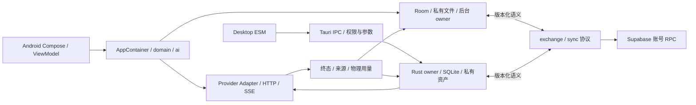

# 南枫 AI 完整开发档案

> 复盘日期：2026-10-15。当前 main 基线 `5a52aa2a8928cc46bad136cb608fd1eb3b62517e`；工作树仍含未提交的联网／协议／思考保存修复及合同整理，不能仅按HEAD重建现装软件。本次只更新档案、长期规则、五类Skill与经验，不改业务源码、配置、Schema或应用测试。旧复盘及代码checkpoint保留原日期；完整范围与本轮验证见[复盘报告](verification/2026-10-15-project-retrospective/REPORT.md)。

当前行为从[合同索引](contracts/CONTRACT_INDEX.md)和[合同治理](CONTRACT_GOVERNANCE_CURRENT.md)进入；模型规则从[统一架构](model-service/MODEL_SERVICE_ARCHITECTURE.md)进入。动态事实看[项目状态](PROJECT_STATUS.md)与[当前交接](CURRENT_HANDOFF.md)。本文保存带日期的复盘，不建立第二套行为权威。

## 1. 复盘方法、范围与证据等级

| 检查层 | 当前覆盖 | 结论边界 |
|---|---|---|
| 全文件清单 | 1,819 跟踪文件；补充337个非忽略未跟踪文件，共2,156个；逐文件大小、类型、SHA-256、目录归属 | 排除 ignored 私有配置、构建物、正式数据库；110个二进制只核身份，未逐图／逐包验收 |
| 全库结构 | 对全部清单文件做适用 JSON/XML/Python/Node/Shell 语法及定位标记扫描；297个Markdown 做标题／引用目录 | 不编译 Kotlin／Rust，不执行 SQL；不是所有代码逐行语义证明 |
| Git 历史 | 全部本地可达refs的191条提交，日期2026-08-20至2026-10-15；其中189条为HEAD祖先链，两条只在其他本地ref可达；逐提交路径/增删统计与代表性记录核对 | 未 fetch；不等于远端全部历史。提交日期／主题不证明开发工时、作者动机或真实部署 |
| 语义核对 | 双端组合根、数据库／迁移、模型目录与 Adapter、附件计划／执行／检查点、费用、同步、网关、CI、签名构建；测试与合同交叉定位 | 源码存在、入口接线、行为测试与真实运行分别表述；不宣称全模块原生验收 |
| 合同与近期证据 | 114 合同／40 领域的登记、分类、owner 与前轮全合同裁决；本轮复核关键源文件及报告 | 分类为CURRENT 24、SCOPED 77、EXPERIMENTAL 8、HISTORICAL 5；owner引用只作导航，不证明功能通过 |

本轮证据：[复盘报告](verification/2026-10-15-project-retrospective/REPORT.md)、[检查摘要](verification/2026-10-15-project-retrospective/summary.json)。[10月14日复盘](verification/2026-10-14-project-retrospective/REPORT.md)仅作历史来源。清单和全历史结构记录在报告所列私有目录，不复制用户正文或 Provider 原始回执。7 个既有 `docs/evidence/p6f2d-android-*.xml` 格式失败保留原件；它们是历史 UI dump，不是本次新源码错误。

## 2. 项目目标与产品边界

### 项目身份

南枫 AI当前以Android与macOS的多模型聊天为第一入口，底层保留附件、项目、知识、记忆、本机备份与选定对话同步能力；用户发送时调用准确模型部署。当前ProductScope只开放CHAT，WORK入口隐藏但独立数据与owner保留；正式设置隐藏开发与诊断，不因底层功能存在重新开放入口。依据：[README](../README.md)、[组合根](../app/src/main/java/com/nanzhufeng/ai/app/AppContainer.kt)、[Desktop 入口](../desktop/src-tauri/src/lib.rs)、[ADR-002](ADR-002-P6A_DESKTOP_AND_EXCHANGE.md)。

[产品简报](product-brief.md)的“首个捕获闭环、暂不做账号／Desktop”等是 2026-08-15 的 V1 范围，不是当前功能禁令。Compare／Agent 的早期优先级也不能证明当前普通发送已启用该实验能力。[模型架构](model-service/MODEL_SERVICE_ARCHITECTURE.md)明确区分生产、独立任务与实验模块。

### 数据安全与产品边界

- CHAT 与 WORK 共用部分交互，持久数据、同步与恢复物理隔离；`projectId=null` 不改变 WORK 身份。TEMP 的模型标识用于本地恢复，不触发 Provider。[C15](C15_WORKSPACE_KNOWLEDGE_PARITY_CONTRACT.md)、[数据区 owner](../app/src/main/java/com/nanzhufeng/ai/data/local/ConversationAreaDatabaseOwner.kt)、[Desktop area](../desktop/src-tauri/src/desktop_data_area.rs)。
- 本地选择／预览不授权外发；普通发送和检索协作绑定精确材料及接收方，原模型身份和未知结果不被静默替换。[运行时合同](ANDROID_RUNTIME_CONTEXT_CURRENT_CONTRACT.md)、[C12](C12_MODEL_NETWORK_PARITY_CONTRACT.md)。
- Google 账号同步新写入为账号隔离的 direct 格式，经 HTTPS/RPC 传输；历史加密 envelope 保留兼容读取与源设备迁移。TLS、账号鉴权、hash 与端到端加密是不同保证。[最新 SQL](../supabase/migrations/202609180007_p8_account_isolated_sync.sql)、[P7F](P7F_SELECTED_CONVERSATION_SYNC_CONTRACT.md)。
- Windows 是独立待验交付目标；macOS 包、浏览器预览和当前 Tauri 源码不能代替 Windows 安装器。[Windows 合同](P6D_WINDOWS_NATIVE_DELIVERY_CONTRACT.md)。

## 3. 技术栈、配置与目录

以下为仓库声明，未查询上游最新版本或价格。

| 层 | 当前配置／实现 | 依据 |
|---|---|---|
| Android 构建 | 单 `:app`；AGP 9.3.1、Gradle 9.5.0、Compose plugin 2.2.10、KSP 2.2.10-2.0.2；minSdk 26、compile/targetSdk 36；正式1.0.30/code94 | [根 Gradle](../build.gradle.kts)、[wrapper](../gradle/wrapper/gradle-wrapper.properties)、[app Gradle](../app/build.gradle.kts) |
| Android 业务 | Kotlin、Compose/Material 3、Room 2.8.4、WorkManager、Credentials/Google ID、PDFBox Android；Keystore 与私有文件 | [依赖及签名门](../app/build.gradle.kts)、[Manifest](../app/src/main/AndroidManifest.xml) |
| Android 数据 | `NanfengAiDatabase` 注解 version 72，连续迁移与 Room schema；CHAT/WORK 各自文件 | [数据库](../app/src/main/java/com/nanzhufeng/ai/data/local/NanfengAiDatabase.kt)、[schemas](../app/schemas)、[area owner](../app/src/main/java/com/nanzhufeng/ai/data/local/ConversationAreaDatabaseOwner.kt) |
| Desktop | HTML/CSS/ESM，无 React/Vite；Tauri 2、Rust 2021、rusqlite 0.37、reqwest 0.12、serde、PDF/ZIP/XML adapter | [package](../desktop/package.json)、[Cargo](../desktop/src-tauri/Cargo.toml) |
| Desktop 身份与存储 | bundle 1.0.30／`com.nanzhufeng.ai.desktop`；`lib.rs` 主库迁移推进至 user_version 44，TEMP 与模型配置另有版本 owner | [Tauri 配置](../desktop/src-tauri/tauri.conf.json)、[主 store](../desktop/src-tauri/src/lib.rs)、[area](../desktop/src-tauri/src/desktop_data_area.rs) |
| 共享协议／维护目录 | exchange v1/v2、sync golden、模型维护 JSON、合同 registry/owner map；不是共享运行时数据库或第二个 ModelRegistry | [protocol](../protocol)、[模型架构](model-service/MODEL_SERVICE_ARCHITECTURE.md) |
| 云服务 | Supabase SQL/RPC/RLS，Google avatar Edge Function 与来源策略 | [migrations](../supabase/migrations)、[头像函数](../supabase/functions/google-avatar/index.ts) |
| 附件中转 | Go 1.24 独立服务、Docker、断点 offset／SHA-256／短时签名 URL | [go.mod](../upload-gateway/go.mod)、[服务](../upload-gateway/main.go)、[部署说明](../upload-gateway/README.md) |

Desktop 的 npm/Cargo 包版本仍为 `0.0.1` 且包名保留 spike；安装包产品版本由 Tauri 配置定义，两者不是同一字段。不能用 npm version 判已安装版本。

### 目录结构

| 目录 | 当前清单及职责 |
|---|---|
| `app/` | 826文件；main Kotlin361（ai31、domain142、data112、ui66等），test Kotlin326；资源、schemas、隔离验收入口 |
| `desktop/` | 289文件；src78、Rust生产目录51、Node 测试 118、scripts 20；前端、IPC、持久 owner、原生封装 |
| `protocol/` | 43文件；版本化格式、公开 fixture、模型／合同维护门 |
| `supabase/`／`upload-gateway/` | 17／5 文件；SQL/头像函数与独立网关源码、测试和部署材料 |
| `docs/` | 918文件；包括合同、ADR、决策、交接、报告、历史原件及差异附件；文件数不是现行合同数 |
| `.agents/skills/`／`scripts/` | 五类项目流程及清单工具；根 scripts 管签名准备、证据、协议／图标等专项验证 |
| `.github/`／`delivery/`／`artwork/` | CI 声明、旧交付清单、预览和图标资产；旧产物摘要不证明最新软件交付 |

目录数字取本轮修改前快照，新生成的报告不会反向计入。大文件如 `lib.rs` 30,297行、`ConversationWorkspace.kt` 11,928行、`app.mjs` 6,989 行是维护集中度事实；本轮未据行数推断功能错误或进行重构。

## 4. 架构与数据流

图表示职责关系，不新增统一状态机或把两端 adapter 当同一代码。Android 的 [Activity](../app/src/main/java/com/nanzhufeng/ai/NanfengAiActivity.kt)、[ViewModel](../app/src/main/java/com/nanzhufeng/ai/ui/ConversationFoundationViewModel.kt)、[AppContainer](../app/src/main/java/com/nanzhufeng/ai/app/AppContainer.kt)组装真实入口；Desktop 的 [app.mjs](../desktop/src/app.mjs)、[chat-shell](../desktop/src/chat-shell.mjs)、[runtime-chat-commit](../desktop/src/runtime-chat-commit.mjs)、[lib.rs](../desktop/src-tauri/src/lib.rs)负责事件、稳定 DOM、IPC 与持久事实。浏览器 fixture 不读取正式 SQLite。

### 普通发送与附件联网

1. 草稿／材料本地准备 → 当前路由与精确身份冻结 → 接收方／材料资格校验 → 持久 Attempt → 实际 Adapter／运输 → 正常完成、已知失败、取消或 UNKNOWN → 正文、来源与独立用量事实落库 → UI 回读。依据：[Android executor](../app/src/main/java/com/nanzhufeng/ai/ai/NormalChatOpenRouterExecutor.kt)、[Desktop 普通回答 owner](../desktop/src-tauri/src/desktop_ordinary_chat_v1.rs)、[P3B](P3B_RUNTIME_EVENT_STATE_MACHINE_CONTRACT.md)。
2. 正常 OpenRouter／官方模型维持各自联网。RC 普通文字 Sol/Astra 自身 Responses；另外四款 RC 文字及六款 RC 附件通过固定 OpenRouter Luna 检索，再交回原 RC 模型／渠道／Key 回答。维护目录当前21个聊天部署：OpenRouter8／官方7／RC6，另1个独立OCR与7组凭据。不是上游可用性承诺。[生成矩阵](model-service/MODEL_SERVICE_MATRIX.md)、[RC 合同](RELAYCORE_MODEL_CURRENT_CONTRACT.md)、[Luna 实施报告](verification/2026-10-13-luna-routing-implementation/REPORT.md)。
3. Muse Wonder 位于深度档 DeepSeek Pro 后、智谱前，经 OpenRouter；可读文字材料使用已登记 Responses 例外，媒体保持原路线。OpenRouter Gemini Flash与Argon自身搜索使用native web plugin例外；Haiku使用同请求入口的exa plugin，关闭搜索／grounded 回答不注入；不把其他模型一起切到 Luna。[Adapter](../app/src/main/java/com/nanzhufeng/ai/ai/ChatProviderAdapters.kt)、[维护矩阵](model-service/MODEL_SERVICE_MATRIX.md)、[Gemini/Muse 报告](verification/2026-10-14-gemini-muse-risk-fix/REPORT.md)、[Gemini 同题报告](verification/2026-10-14-gemini-search-repeat/REPORT.md)。
4. 编号报告按完整事实句／分号提取独立 ID，保留必要段落上下文与参考 URL，过滤个人材料／评述控制句；逐项来源与实际搜索状态独立判定。Android 常规四项一批，智谱一项；执行受 48 次／600 秒边界约束。已知完成但缺证可以定向补查，UNKNOWN 停止；补查失败不能删除已有证据。[Android planner](../app/src/main/java/com/nanzhufeng/ai/ai/AttachmentWebSearchPlan.kt)、[coordinator](../app/src/main/java/com/nanzhufeng/ai/ai/AttachmentWebSearchCoordinator.kt)、[Rust planner](../desktop/src-tauri/src/attachment_web_search_v1.rs)、[执行](../desktop/src-tauri/src/attachment_web_search_execution_v1.rs)。
5. 检索检查点验证任务／ID／query／原模型／来源／完成调用与有效期，当前语义v6拒绝旧v5与topic-v4证据；它不是 Provider token cache 或未接入的 LocalExactReuse。[Android cache](../app/src/main/java/com/nanzhufeng/ai/ai/AttachmentSearchCheckpointCache.kt)、[Rust checkpoint](../desktop/src-tauri/src/attachment_search_checkpoint_v1.rs)、[缓存合同](PROMPT_CACHE_AND_EXACT_REUSE_CONTRACT.md)。

### 费用、导入、同步与后台

- 每次物理 Call 保存准确身份、usage、币种／结算或估算快照；失败不抹掉已返回费用，未知不当零。费用页把同一次提问的多笔 Luna 检索合并展示，原回答单列；消息页脚统计该次总额，已知＋未知保持可见。账本物理调用不合并或重算历史。[费用合同](AI_USAGE_COST_AND_BALANCE_LEDGER_CONTRACT.md)、[Desktop 投影](../desktop/src/usage-ledger-display.mjs)、[双端分组证据](verification/2026-10-13-retrieval-cost-grouping/REPORT.md)。
- 附件／ZIP／备份：格式与大小预检 → 私有 staging → 资产 hash／source identity／occurrence → 事务或 journal 提交 → receipt／关闭重开。Android 与 Desktop 的资产、数据库及备份 owner 独立，exchange 转换只在边界。[P2A](P2A_LOCAL_DATA_AND_ATTACHMENT_CONTRACT.md)、[P5D](P5D_LOCAL_BACKUP_RESTORE_DELIVERY_CONTRACT.md)、[P6K](P6K_CHATGPT_CLAUDE_ZIP_IMPORT_ADOPTION_CONTRACT.md)。
- 同步：用户选择 → area/document identity → 账号范围 RPC 与 optimistic revision → serializer／字段版本合并 → 本地 receipt 与 UI 刷新。标题、列表成员、正文与费用各有事实来源；source/target 两端均需验证。[Android sync](../app/src/main/java/com/nanzhufeng/ai/data/P7FManualConversationSync.kt)、[Desktop sync](../desktop/src-tauri/src/desktop_account_sync_v1.rs)、[P7F](P7F_SELECTED_CONVERSATION_SYNC_CONTRACT.md)。
- 长任务由持久执行／后台 owner 管，不因返回页面生成第二次请求；通知、转写、提醒、岛与取消投影不能从显示文案猜进度。Android Manifest 的前台服务与 WorkManager、Desktop background/通知 owner 分别有平台边界。[后台合同](P5B_BACKGROUND_CANCELLATION_BATTERY_CONTRACT.md)、[南枫岛](NANFENG_ISLAND_CURRENT_CONTRACT.md)、[Desktop runtime](../desktop/src-tauri/src/desktop_background_runtime_v1.rs)。

## 5. 核心模块

| 模块 | owner／行为依据 | 审核重点 |
|---|---|---|
| 会话、分支、草稿、生命周期 | [RoomConversationRepository](../app/src/main/java/com/nanzhufeng/ai/data/local/RoomConversationRepository.kt)、[C13](C13_CONVERSATION_LIFECYCLE_PARITY_CONTRACT.md)、[Desktop chat](../desktop/src-tauri/src/desktop_ordinary_chat_v1.rs) | 身份、revision、恢复、取消、迟到回读与失败保稿 |
| 模型选择、发送、联网 | [ChatProviderAdapters](../app/src/main/java/com/nanzhufeng/ai/ai/ChatProviderAdapters.kt)、[Desktop model](../desktop/src-tauri/src/desktop_model_service_v1.rs)、[C12](C12_MODEL_NETWORK_PARITY_CONTRACT.md) | 目录／实际协议／授权／来源／终态／费用共同验证 |
| 项目、知识、记忆、上下文 | [domain](../app/src/main/java/com/nanzhufeng/ai/domain)、[Desktop history](../desktop/src-tauri/src/desktop_history_knowledge_v1.rs)、[C15](C15_WORKSPACE_KNOWLEDGE_PARITY_CONTRACT.md) | scope、人工选择、资料修订、派生索引与跨区引用 |
| 资产、解析、搜索、备份 | [Android backup](../app/src/main/java/com/nanzhufeng/ai/data/AndroidLocalBackupRestoreManager.kt)、[Desktop backup](../desktop/src-tauri/src/desktop_local_backup_v1.rs)、[C14](C14_LOCAL_DATA_PARITY_CONTRACT.md) | 物理文件／引用计数／预览／恢复 journal 不混用 |
| 账号、同步、凭据 | [P7F session](../app/src/main/java/com/nanzhufeng/ai/data/P7FGoogleAccountSession.kt)、[Desktop sync](../desktop/src-tauri/src/desktop_account_sync_v1.rs)、[P7F](P7F_SELECTED_CONVERSATION_SYNC_CONTRACT.md) | 账号隔离、精确材料、Secret 读取时机、源迁移 |
| 提醒、监控、转写 | [Desktop reminders](../desktop/src-tauri/src/desktop_reminders_v1.rs)、[transcription](../desktop/src-tauri/src/desktop_transcription_v1.rs)、[Android 转写 UI 合同](ANDROID_TRANSCRIPTION_UI_CURRENT_CONTRACT.md) | 本地状态、付费外部动作、通知权限／OS 生命周期分别验收 |
| UI、皮肤、字体、复制 | [ConversationWorkspace](../app/src/main/java/com/nanzhufeng/ai/ui/ConversationWorkspace.kt)、[app.mjs](../desktop/src/app.mjs)、[C16](C16_THEME_FONT_OVERLAY_PARITY_CONTRACT.md)、[页脚复制证据](verification/2026-10-14-footer-text-copy/REPORT.md) | 原生选择、窄屏、大字体、滚动／焦点与持久事实投影 |
| 协议、云端、网关、治理 | [protocol](../protocol)、[Supabase](../supabase)、[网关](../upload-gateway)、[领域 owner map](contracts/DOMAIN_OWNER_MAP.md) | 格式兼容、RPC/RLS、offset／TTL、部署事实及模块限定 |

完整领域导航由owner map维护，本文不复制其完整路径集合。实验 Compare、离线捕获、旧协议与普通聊天分别读适用 scope，不能凭文件存在启用外部动作。

## 6. 关键决策与原因

仅记录文档明确陈述的原因；代码形状或提交主题不足以补造动机。

| 决策 | 已记录原因／取舍 | 依据 |
|---|---|---|
| 本地优先、发送绑定材料与接收方 | 选择／预览不应外发；实际调用必须归因，不静默扩大范围 | [运行时合同](ANDROID_RUNTIME_CONTEXT_CURRENT_CONTRACT.md)、[决策日志](decision-log.md) |
| 双端独立数据库、共享版本化语义 | Room 与 Desktop SQLite 的表／资产生命周期不同；协议边界允许兼容，不复制数据库 | [ADR-002](ADR-002-P6A_DESKTOP_AND_EXCHANGE.md)、[exchange](NFAI_EXCHANGE_V1_CONTRACT.md) |
| CHAT/WORK 物理隔离 | 仅 `projectId` 过滤不能隔离消息、搜索、同步与恢复；无项目 WORK 仍需身份 | 提交 `1580faf50874`、[C15](C15_WORKSPACE_KNOWLEDGE_PARITY_CONTRACT.md) |
| direct 同步、保留旧 envelope | 已确认账号隔离方案不以恢复材料阻塞日常同步，同时不能删除尚需源迁移的旧记录 | [P7F](P7F_SELECTED_CONVERSATION_SYNC_CONTRACT.md)、[SQL](../supabase/migrations/202609180007_p8_account_isolated_sync.sql) |
| RC Luna 搜索后原模型回答 | 保留有效自身联网；将存在缺口的 RC 场景按最终目标分流，搜索与最终分析分工，禁静默 fallback | [10月13日目标方案](model-service/SEARCH_ROUTING_TARGET_PLAN_2026-10-13.md)、[实施证据](verification/2026-10-13-luna-routing-implementation/REPORT.md) |
| 原生来源＋正常终态决定联网成功 | HTTP 200、模型自述、正文 URL 或局部工具事件不足；局部失败也不能覆盖真实最终完成 | [10月10/13日决策](decision-log.md)、[DeepSeek 修复](verification/2026-10-13-deepseek-terminal-fix/REPORT.md) |
| 物理记账与费用展示分开 | 用户允许多次搜索，但要求检索统计合并、回答独立；历史调用与币种必须保真 | [费用分组决策](decision-log.md)、[分组报告](verification/2026-10-13-retrieval-cost-grouping/REPORT.md) |
| 事实粒度与检查点隔代 | 一主题有来源不代表全部数字／断言已核实；旧主题回执不能证明新事实范围 | [事实优化](verification/2026-10-14-attachment-fact-granularity/REPORT.md)、[风险复核](verification/2026-10-14-attachment-fact-risk-review/REPORT.md) |
| 平台独立正式交付与证据绑定 | 签名、环境、保数据和原生接受条件不同；截图与 Release 需绑定真实候选 | [发布策略](GITHUB_REPOSITORY_AND_RELEASE_POLICY.md)、[决策日志](decision-log.md) |
| 附件联网不按主题或核验关键词设门槛 | 用户要求支持所有已实现材料与主题；无本地线索时先由已批准原选模型忠实读取，不能用泛化搜索或无关来源代替 | [全主题合同](C12_MODEL_NETWORK_PARITY_CONTRACT.md)、[修复报告](verification/2026-10-15-attachment-search-all-topics/REPORT.md) |
| 合同按 scope 和 owner 治理 | 旧阶段或实验规则不能倒灌现行实现；路径与分类只作维护导航 | [全合同裁决](verification/2026-10-14-contract-implementation-unification/REPORT.md)、[治理](CONTRACT_GOVERNANCE_CURRENT.md) |

## 7. 开发过程与代表性修复

### 已提交历史

本地全部ref可达提交8月142条、9月40条、10月9条；主HEAD祖先链189条，另两条checkpoint/文档记录不在主链上，不重复计为当前主线开发。下表只描述记录和对应代码范围，不推断历时或部署结果。

| 日期／提交 | 记录与演进 |
|---|---|
| 2026-08-20 `e56d666d89ac` | 建立项目基线（756 路径）：Android、本地数据、合同与工具初始集合 |
| 2026-08-23 `d61805cea24e` | 普通聊天直接发送 OpenRouter，与 mock／预览区分 |
| 2026-08-24 `1ded3da7e486` | Provider 聊天和会话 shell checkpoint（138 路径） |
| 2026-09-01 `242ed1ec8200` | Android/Desktop checkpoint（186 路径），双端功能与入口推进 |
| 2026-09-13 `b11d3a0735f1` | Desktop 自动标题持久化修复 |
| 2026-09-15 `50f4b32f5284`／`ff9fd332636a` | 同步事实统一、双端修复及交付证据归档 |
| 2026-09-18 `1580faf50874` | 工作区物理分库与同步加固（97 路径） |
| 2026-09-18 `d1929634c9dd` | 双端 Markdown 格式与来源保留，版本 1.0.21 |
| 2026-09-19 `4ced523f73cf`／`dafc64d9b336` | 原生联网／消息操作修复至 1.0.22；记录当时 Release 交付，后者为该次旧复盘HEAD |
| 2026-10-14 `196233296e5d`／`cd49d91242eb` | 主链代码checkpoint纳入651路径及最终回归回执；旧d519e83/8d434cb仍在其他ref可达，不作为另一轮主线实现 |
| 2026-10-14 `a69447ded567`／`d64d71026418` | 1.0.29候选与GitHub交付记录；发布事实以当时回执为准 |
| 2026-10-15 `7c4245666bf9` | 1.0.30联网、Argon与自动标题增量，95路径；不是后续Haiku/TLS/全主题修复的源码点 |
| 2026-10-15 `0494e0f23069`／`5a52aa2a8928` | v1.0.30产物／四张预览及远端下载、CI回执；后者为当前HEAD，仍不包含本轮工作树修复 |

### 当前未提交演进

10月14日checkpoint已把此前大量WIP纳入主链；下表保留阶段过程，不能再将整段十月工作统称未提交。10月15日HEAD之后的全主题、隐藏诊断、Haiku/TLS、其他模型与合同修复仍为工作树增量，范围以本轮清单、差异和带日期报告为准，旧失败保留。

| 阶段 | 记录的变化与验证边界 |
|---|---|
| 10月9–12日模型／协议维护 | 精确部署身份、RC 分组、接口/推理参数和任务 routing 演进；[模型架构](model-service/MODEL_SERVICE_ARCHITECTURE.md)与[矩阵](model-service/MODEL_SERVICE_MATRIX.md)汇总当前实现，不等于全部服务可用 |
| 10月13日 Luna 接线 | 来源映射、材料授权、原 RC 回答、20 部署及14格式实测；RC Pro404／当时Muse403仍失败，[报告](verification/2026-10-13-luna-routing-implementation/REPORT.md)逐模型限定 |
| 10月13日长报告／费用 | 删除重复 Composer 提示、混合币种页脚、物理费用保留／展示合并；原长报告部分覆盖和 Mac UNKNOWN 未被小样本抹去，[报告](verification/2026-10-13-real-report-footer-fix/REPORT.md) |
| 10月13日终态／用量 | DeepSeek 局部工具错误误锁失败、Sol/RC协议终态及Gemini usage 缺失分别修复；[DeepSeek](verification/2026-10-13-deepseek-terminal-fix/REPORT.md)、[RC用量](verification/2026-10-13-rc-gemini-usage/REPORT.md) |
| 10月14日 Gemini/Muse | Muse Responses 可读材料例外、Gemini native plugin 同题短答、失败计量恢复；双端普通文字实际通过，新媒体／完整原件未全验，[两模型](verification/2026-10-14-gemini-muse-risk-fix/REPORT.md)、[Gemini同题](verification/2026-10-14-gemini-search-repeat/REPORT.md) |
| 10月14日原位复制／事实优化 | 页脚选择、完整事实句、v5缓存及五类解析遗漏修复；原件离线66项/17批只证明计划，[复制](verification/2026-10-14-footer-text-copy/REPORT.md)、[事实风险](verification/2026-10-14-attachment-fact-risk-review/REPORT.md) |
| 10月14日正式覆盖／合同收口 | 双端1.0.29原签名保数据覆盖；之后40合同＋治理与维护工具统一，没有改变已装包或增加费用，[安装](verification/2026-10-14-fact-risk-cover-install/REPORT.md)、[合同](verification/2026-10-14-contract-implementation-unification/REPORT.md) |
| 10月15日发布 | [v1.0.30发布回执](verification/2026-10-15-github-v1.0.30/REPORT.md)记录APK/DMG/校验文件下载hash与三项CI；发布源码点不等于其后同版本覆盖包 |
| 10月15日附件全主题与Haiku | 删除主题/核验词门槛，原选模型先忠实读原件再搜索；Haiku采用精确检索兼容例外，Android修流式能力及握手前恢复。[全主题](verification/2026-10-15-attachment-search-all-topics/REPORT.md)、[Haiku/TLS](verification/2026-10-15-haiku-tls-streaming/REPORT.md) |
| 10月15日其他模型 | 修DeepSeek最终阶段来源要求、Mac非流式协议、RC Opus别名与Android完成后思考保存；双端正式覆盖，RC Pro仍未闭环。[报告](verification/2026-10-15-other-model-network-review/REPORT.md) |
| 10月15日合同治理 | 全114合同/40领域复核，18份正文统一；29项维护测试，业务输入不变。[报告](verification/2026-10-15-contract-unification/REPORT.md) |

### 踩坑与修复证据

| 触发／问题 | 修复与证据 | 仍需区分 |
|---|---|---|
| PostgreSQL 大密文正则上限执行失败 | 字符集与长度分开验证，[SQL](../supabase/migrations/202609130003_p7g_fix_large_ciphertext_validator.sql) | SQL 存在不证明已部署 |
| Desktop 流式重建 shell 丢滚动／选择 | 稳定 DOM 提交与迟到回读处理，[runtime](../desktop/src/runtime-chat-commit.mjs) | 浏览器行为不覆盖原生系统选择 |
| 自动标题失败影响正文或手动标题 | 标题独立终态、长度与手工保护，[title owner](../desktop/src-tauri/src/desktop_conversation_title_v1.rs)、[决策](decision-log.md) | 标题服务仍有真实上游边界 |
| Luna annotations／跟踪 URL 对应不上来源 | 原生来源映射、严格项ID/相关性，[实施报告](verification/2026-10-13-luna-routing-implementation/REPORT.md) | 不能把正文自写链接当证明 |
| DeepSeek 搜索额度耗尽被判整段未完成 | 最终实际来源＋正常终态优先，保留用量，[红绿/同题](verification/2026-10-13-deepseek-terminal-fix/REPORT.md) | 截断／缺来源仍失败 |
| 有回复但金额未知、失败后费用丢失 | RC 请求 usage、双端计量交接、cost-only 本地恢复，[RC](verification/2026-10-13-rc-gemini-usage/REPORT.md)、[双端补漏](verification/2026-10-14-gemini-muse-risk-fix/REPORT.md) | 旧无回执费用无法凭空补账 |
| Gemini 短题有源但截图同题跳搜索 | 精确模型 native plugin 兼容例外＋同题短答双端真验，[报告](verification/2026-10-14-gemini-search-repeat/REPORT.md) | 例外有后续接口维护风险，不能泛化全部模型 |
| 开篇／BOM／点评链接／元数据误删／多URL粘连 | 9个公开用例/25事实断言，两端实际planner一致，[报告](verification/2026-10-14-attachment-fact-risk-review/REPORT.md) | 提取正确不等于事实已核实 |
| 历史标题编号漏排或“历史资料库”被误隐藏 | 维护 parser 区分显式历史章节与当前业务主题，27项回归，[合同统一](verification/2026-10-14-contract-implementation-unification/REPORT.md) | 元数据绿灯不替代逐条行为语义 |
| 读图成功却搜了无关内容／仍说无工具 | 原件读取、主题/事项计划、相关来源和最终回答阶段分别传递事实，拒绝把读取证明当搜索证明；[全主题修复](verification/2026-10-15-attachment-search-all-topics/REPORT.md) | 不将有来源扩大为事实准确性或全格式验收 |
| 目录缺stream字段／TLS握手中断 | 接口流式能力不依赖supported_parameters；仅尚未写出正文且符合已证实EOF/Socket握手原因恢复一次；[Haiku/TLS](verification/2026-10-15-haiku-tls-streaming/REPORT.md) | 证书错误、已发正文与UNKNOWN不自动重发 |
| 最终阶段重复要求搜索、JSON解析成choices | 阶段标记来自执行owner，按实际Messages/Responses协议解码；[其他模型复查](verification/2026-10-15-other-model-network-review/REPORT.md) | 检索阶段来源门与最终完整终态仍分别成立 |
| 服务已回思考却提示未保存 | 不能用不可变save改完成消息；专用Room事务核对绑定并幂等追加可选元数据，保正文/费用/活动时间；同报告 | 本地保存失败不归因API没返回；最新补丁未新增付费重测 |
| 监督脚本首行当整轮结束 | 等全部目标结果和最终cleanup，兼容部分JSON；保留Pro中断未知，不自动补发；同报告 | 接口目录200不证明生成成功，未知费用不计零 |

## 8. 测试、验证与交付方式

### 最新证据及本轮执行范围

本次是复盘文档，不重跑完整应用构建或付费链路。以下旧执行结果均注明阶段；测试数不是覆盖率。

| 验证层 | 已记录结果／本轮用途 | 依据与边界 |
|---|---|---|
| Android JVM | 10月15日其他模型最终1535总，1525 PASS／10 opt-in skip、326套件、0失败错误 | [模型复查](verification/2026-10-15-other-model-network-review/REPORT.md)；本轮未重跑，应用输入保持；不是主设备业务验收 |
| Rust | 同阶段457 PASS／36 ignored、0失败 | 同报告；本轮未重跑，不替代全部Mac原生场景 |
| Desktop Node | 历史完整551 PASS／12 skip及其后定向合同；没有本轮新增全套Node执行 | [10月14覆盖报告](verification/2026-10-14-fact-risk-cover-install/REPORT.md)与最近专项报告分别限定 |
| 构建／签名／覆盖 | 前轮正式Android Release/Lint、Mac正式构建与验签通过；最后Android思考包原签名覆盖并精确APK读回，Mac1595数据文件0变化 | [模型复查](verification/2026-10-15-other-model-network-review/REPORT.md)；本轮不再构建或安装 |
| 真实服务 | Haiku样例76.8秒；DeepSeek Flash12.7秒/GLM Flash92.3秒双附件2/2；RC Flash仅1+1成功 | [Haiku](verification/2026-10-15-haiku-tls-streaming/REPORT.md)、[其他模型](verification/2026-10-15-other-model-network-review/REPORT.md)；三者不构成21模型×全格式矩阵，思考保存修复在后，只用本地Room重开验证 |
| RC Pro | 历史404；本轮控制被监督脚本提前中断，SENDING／结果与费用未知，目录仍列ID | 同报告；未重发、未换Key或preview，不计通过 |
| 合同与本轮复盘 | 前轮29维护测试；本轮重新全量清单/结构、合同/模型门、链接/Skill与输入hash核验 | [本轮报告](verification/2026-10-15-project-retrospective/REPORT.md)记录实际新执行，不复用应用数字冒称本轮运行 |
| 更早材料范围 | 20模型/14格式阶段、v5原件66项/17批等仅说明当时范围 | [Luna](verification/2026-10-13-luna-routing-implementation/REPORT.md)、[v5风险报告](verification/2026-10-14-attachment-fact-risk-review/REPORT.md)；不能证明v6全主题实际完成 |

可用验证入口见[测试交付 Skill](../.agents/skills/nanfeng-ai-testing-delivery/SKILL.md)。Android JVM XML 的 skip 与 Rust ignored 必须单列；`verify-test-xml.sh` 将任意 skip 判非零，不能把合法 opt-in skip 混成通过或业务失败。定向测试会覆盖报告目录，复用前先保存对应源码点摘要。

[CI](../.github/workflows/source-verification.yml)当前声明协议／Supabase静态／Go、模型及合同门、Desktop语法/typecheck/build/Rust、Android compile-only。未声明完整 Android JVM／Node 全套／正式签名包／原生和真实服务；CI定义存在不代表当前云端结果；仓库v1.0.30发布回执记录了当时三项成功，本轮未查远端。当前workflow只调用合同登记门及其测试，没有调用audit-contract-consistency.py与对应测试，属于维护门未全部上CI的缺口；本轮不改CI配置。

### 部署与保数据交付

- **Android**：正式候选通过 `:app:lintRelease :app:assembleRelease`，完整签名配置由环境变量优先／用户级专属 Gradle 属性备用；任一可安装包构建受签名门保护。独立验收变体有后缀身份；同签名 Debug 也不得覆盖主设备。[app Gradle](../app/build.gradle.kts)、[正式签名](ANDROID_FORMAL_SIGNING.md)。
- **macOS**：`npm --prefix desktop run bundle:macos` 先构建静态产物，再 Tauri app；脚本读取本机公开云配置并选择环境指定／可用 Apple Development 身份，codesign严格验签和DMG验证。脚本选到证书不保证与已装一致，覆盖前仍需比对身份与数据。未在该脚本实现 notarization。[bundle脚本](../desktop/scripts/bundle-macos.mjs)、[Tauri配置](../desktop/src-tauri/tauri.conf.json)。
- **已完成的本地覆盖**：10月15日同版本1.0.30双端原证书保数据覆盖；Android最后思考补丁候选SHA以[模型复查安全摘要](verification/2026-10-15-other-model-network-review/verification.json)为准，精确APK读回、应用/首装/数据目录身份保持。该身份检查不等于完整私有数据库hash；Mac1595数据文件逐项不变。覆盖不替代主设备新业务生成。
- **Supabase／网关**：按有序migration与头像函数部署，网关需要HTTPS、持久卷、专属token、TTL与offset/hash校验。仓库没有证明目标服务现部署版本；本轮不读取secret或创建资源。[SQL](../supabase/migrations)、[头像](../supabase/functions/google-avatar)、[网关部署](../upload-gateway/README.md)。
- **GitHub**：README与[仓库发布回执](verification/2026-10-15-github-v1.0.30/release-receipt.json)记录v1.0.30，标签0494e0f、构建7c42456，APK／DMG／校验文件均曾下载比对成功。当前HEAD后的同版本修复覆盖包尚未提交／上传；相同版本不代表相同源码或字节。本轮未fetch／提交／推送或查询远端当前状态。

## 9. 文档冲突与裁决

| 旧来源／断言 | 当前证据与裁决 | 本轮处理 |
|---|---|---|
| 档案仍写182提交／20模型／1.0.29／v5 | 当前191条本地可达、189主链；manifest21聊天模型，产品1.0.30，附件证据v6 | 更新对应正文/目录/技术栈/测试，不只顶部免责 |
| 十月工作全部未提交 | 1962332/7c42456已纳入前期工作；HEAD后的修复仍是WIP | 阶段过程与提交归属分开；两条非主链checkpoint不重复叙述为新主线 |
| README仍指1.0.22、最新1.0.29远端未确认 | 当前README和仓库回执记录v1.0.30下载校验及CI；后续同版本覆盖另有hash | 更新交付正文，保留本轮未查远端边界 |
| 旧fixture禁联网／无production caller／未连接账号等 | [全合同统一](verification/2026-10-15-contract-unification/REPORT.md)按当前owner分清平台、模块与历史范围 | 复用18份已修合同裁决，不再修改业务或重做合同 |
| “服务未返回思考” | 实际有reasoning，失败发生在本地不可变save；Room专用追加owner已修 | 记录纠正因果和测试边界，不回写旧真实回执 |
| “联网工具缺失”可一概由模型能力解释 | Haiku真实记录为TLS握手失败；另外存在流式目录、材料主题、协议解码等独立问题 | 按实际失败阶段写根因，不用同一概括覆盖所有问题 |
| About旧ad-hoc占位／npm0.0.1与产品版本不同 | 实际身份归构建签名与安装回执，产品版本归Tauri配置，内部包号是另一字段 | 保留源码占位可达性/维护风险，不改配置或用户文案 |
| 旧链接失败43项 | 本轮1625个相对链接检查发现37项，均位于before-docs迁移快照 | 不改冻结原件或伪造文件；交付文档/Skills单独验链接 |

## 10. 已知问题与后续路线

| 状态 | 问题／缺口 | 下一步及依据 |
|---|---|---|
| 未完成验收 | 当前v6全主题／逐事实的更广Provider逐项返回、原长报告完整核验与原模型长答 | 先回放已有安全回执，最小事实样本贯通；原件全量前评估费用，离线66项不替代。[风险报告](verification/2026-10-14-attachment-fact-risk-review/REPORT.md) |
| 既有真实失败 | RC Gemini Pro历史404、本轮控制中断结果/费用未知；旧Mac原件UNKNOWN、Sol另一题504仍有历史证据 | 精确场景、渠道与终态定位，不静默换模型／自动重发UNKNOWN。[状态](PROJECT_STATUS.md) |
| 部分已解决、范围未全验 | Muse模型身份已确认且普通文字双端通过；新Responses可读多附件及媒体未全部闭环。Gemini短答同题通过，完整长答/新媒体边界未全验 | 不继续笼统称“都未联网”，也不把短题成功扩大成全场景。[Muse](verification/2026-10-14-gemini-muse-risk-fix/REPORT.md)、[Gemini](verification/2026-10-14-gemini-search-repeat/REPORT.md) |
| 原生验证缺口 | 正式双端新版UI/picker/生命周期/扫描与媒体；页脚原位复制Mac只有浏览器证据 | 对准确候选与隔离根进行原生回放；模拟器不能冒充OPPO，浏览器不能冒充Mac。[复制报告](verification/2026-10-14-footer-text-copy/REPORT.md) |
| 源码事实／运行待确认 | About旧占位与巨型入口集中度 | 先确认当前可达路径与实际状态投影；若后续获修复授权，按owner拆小增量并复验，不在纯文档任务重构 |
| 外部状态未确认 | Supabase实际迁移/RLS/RPC/头像部署、真实Google跨端同步、网关现部署状态 | 仓库检查先完成，外部验证另按授权与真实账号范围；静态SQL不证明线上隔离 |
| 交付未确认 | HEAD后同版本覆盖修复的后续公开发布、Windows构建/签名/安装、公证 | 仓库已有v1.0.30旧发布回执；最新WIP覆盖包没有新的公开发布回执，不承诺Windows。[发布策略](GITHUB_REPOSITORY_AND_RELEASE_POLICY.md) |
| 维护门覆盖缺口 | CI未接入当前合同一致性脚本/测试 | 后续获准配置任务再补，当前本地检查正常；不能把云端三项历史成功算作此门已运行。[workflow](../.github/workflows/source-verification.yml) |
| 维护残余 | 7历史XML原件非标准格式、模型例外与外部协议可能变化 | 格式失败分类保留；精确例外迁移需真实同题来源、用量与身份。上游当前价格/能力本轮未查询 |
| 历史引用待恢复 | 本轮相对链接扫描有37项既有缺失，全部在迁移位置的before-docs快照；绝对本机路径不作为便携链接通过的证明 | 不改写冻结原件或伪造文件；恢复历史证据时按原始文档基址解释链接，并另建可用证据入口。[本轮报告](verification/2026-10-15-project-retrospective/REPORT.md) |

后续路线是上述证据缺口的建议顺序，不是已授权开发或服务部署：先消除具体当前失败与新事实链路缺口，再补原生入口与材料正交矩阵，最后做账号／发布／其他平台验收。保持正常自身联网、原模型回答、历史费用与用户数据；不以“大重构”或更多测试数量代替可观察闭环。
